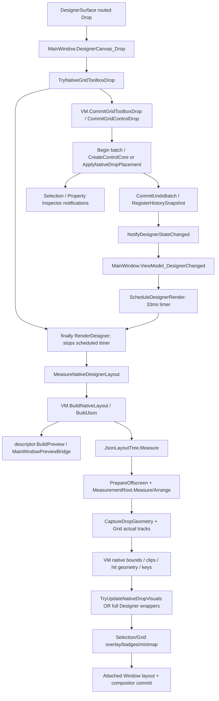

# Incremental Layout Projection и Undo — архитектурная оценка Phase 7A.3

Дата: 1 ноября 2026. Исходный commit: `dfa8570f9ef472fd73b74a3d385e54f1bc1e59f0`. Исходное дерево Git чистое. Основа: LayoutDesignerPhase7A2.md; дополнительно сверены текущие projection, lifecycle и Undo реализации. **Production-код, NuGet, TargetFramework, Preview/Export/VSIX, темы и default Canvas не изменялись. PoC не реализован.** Изменения ограничены исследовательским smoke harness и этим отчётом.

## 1. Основной вывод

Инкрементальное обновление **объектов projection** совместимо с текущей моделью. Инкрементальность вычисленной геометрии нельзя гарантировать по границе редактируемого контейнера: Auto/Star/desired size/spacing/reflow могут затронуть предков и соседние ветви. Не нужен второй layout engine или новая Document Model. Нужны ограниченное временем жизни сохранённое Avalonia-дерево, достоверная классификация изменений, проверка model identity и обновление существующей геометрии после настоящего layout.

Это техническая осуществимость, а не доказанное ускорение ещё не реализованного пути. Ни полученные измерения, ни суммы stage durations не дают права обещать конкретное снижение median/P95 после cache. Приведён ниже бюджет существующей работы, а не выдуманный after.

Undo не следует переписывать на commands/copy-on-write только ради 500 controls. Следует разделить сохранение снимка, обновление подписей истории и восстановление целого документа. Подписи истории сейчас заново десериализуют старые snapshots; это отдельный кандидат на точечную оптимизацию без изменения надёжного snapshot storage.

**Grid-first: NOT READY для безусловного переключения default сейчас.** Это консервативная выпускная оценка, не CI fail по выдуманному порогу151ms и не вывод «500 controls слишком медленно». На 20–50 forms основные операции по медиане уже приемлемы; на100 Text edit достигает150.8/207.1ms, прямой Undo242.6/261.1ms, Grid Add с обычной history30 —183.2/207.4ms. Physical DnD/DPI и редкая UIA-проблема не закрыты. **Не доказано, что эти проблемы уникальны Grid:** Canvas100/H30 также157.1/253.9ms. Полная переделка projection/Undo **не является обязательной предпосылкой** Grid-first; сначала нужны общие адресные улучшения и UX/stability acceptance. Недостаточно требовать ускорения synthetic500 или объявлять архитектуру Grid непригодной.

Ответ по Undo: **сохранить full snapshot storage сейчас разумно**. На короткой истории Add/Move/Reparent capture у 20–100 forms занимает единицы ms; сам Serialize существующего DTO100 — P50 1.53/P95 1.78 ms. Но **оптимизировать сопутствующее построение captions уже имеет смысл**: H30/N100 — P50 58.98/P95 153.05 ms и17.20 MiB за один rebuild; Commit в VM-only таком состоянии — 60.54/136.58 ms и18.91 MiB. Это не повод заменять Undo на commands; сначала убрать повторный разбор неизменённых старых snapshots и проверить ROI.

**Количество производительности, которое даст incremental projection, пока не измерено:** after отсутствует, поскольку PoC запрещён на этом этапе. Непосредственный существующий native budget у Property100 — около6ms, у500 — около51ms, причём часть Measure/geometry всё равно останется. Сбережение control/template allocations возможно; end-to-end выигрыш зависит также от GC/layout/frame pacing. Обещать100ms или кратное ускорение только по этим суммам нельзя. Наиболее убедительный обычный UI-бюджет сейчас связан с history: Move100 H0/H30 —78.8/163.5ms при почти неизменном native measurement7.3/6.2ms.

## 2. Три разных дерева, которые нельзя смешивать

| Представление | Реальная реализация | Время жизни и назначение |
|---|---|---|
| Авторская модель | DesignerDocumentSession.Controls, DesignControlModel, ParentId, StackOrder; DesignerDocumentFileModel | ActiveSession владеет моделью одной формы; DTO хранит JSON/экспортируемое состояние |
| Измерительная projection | AxamlLayoutProjection.JsonLayoutTree: Root, Controls, Parents, GridPanels, ContainerPanels | Сейчас создаётся для очередного измерения; настоящие Grid/StackPanel/WrapPanel/DockPanel/Canvas и leaf controls |
| Attached Designer | MainWindow._wrapperByControlId; служебный DesignerCanvas, frames/grips/overlays; leaf preview внутри wrapper | Visible editor tree; часть wrappers переиспользуется при Drop. Это **не** дерево JsonLayoutTree.Controls |
| Runtime Preview/Export | PreviewWindow native root / runtime AXAML loader; generated AXAML/C# | Отдельные controls, DataContext, ItemsSource, lifecycle и реальные Window layout passes |

DesignerSurface — host-neutral UserControl, передающий pointer/DragDrop события host-у; собственный layout engine внутри него не спрятан. Основная оркестрация остаётся в MainWindow. Переносить её целиком в Surface ради cache не требуется.

Ключевые места кода:

- `Views/DesignerSurface.axaml.cs`: constructor, OnCanvasDragOver/OnCanvasDrop, AttachSession/DetachSession.
- `Views/MainWindow.GridDrop.cs`: TryNativeGridToolboxDrop, UpdateNativeGridDropPreview, grid pointer commit.
- `Views/MainWindow.axaml.cs:1677`: ViewModel_DesignerChanged/ScheduleDesignerRender; timer interval **33 ms** задан в constructor; `:2779` RenderDesigner; `:4589` CreatePreviewControl; `:4795` CreateButtonPreview.
- `Views/MainWindow.NativeLayout.cs:31`: MeasureNativeDesignerLayout.
- `ViewModels/MainWindowViewModel.NativeLayout.cs:27`: BuildNativeLayout.
- `DesignerSystem/AxamlRoundTrip/AxamlLayoutProjection.Json.cs:24`: JsonLayoutTree/Measure; `:66` BuildJson; ApplyJsonLayout.
- `DesignerSystem/AxamlRoundTrip/AxamlLayoutProjection.cs:18`: MeasurementRoot; `:148` PrepareOffscreen.
- `DesignerSystem/AxamlRoundTrip/AxamlLayoutProjection.DropGeometry.cs:26`: CaptureDropGeometry.
- `ViewModels/MainWindowViewModel.NestedDrop.cs:100`: UpdateNativeLayoutMeasurements; ResolveLayoutDropTarget.
- `Views/MainWindow.LayoutUx.cs:66`: TryUpdateNativeDropVisuals; NativeContentKey и Canvas append fast path.

## 3. Call graph



Важно: scheduled timer + synchronous finally — не обязательно два render. RenderDesigner останавливает timer, а measured counters проверяют реальное число вызовов. В старом helper принудительный f.Refresh после pointer release давал искусственный второй render; новый benchmark его внутри операции не вызывает.

## 4. Что projection делает сейчас

BuildNativeLayout сначала материализует DTO всей активной формы (`CreateDocumentFileModel`) и массив моделей. BuildJson создаёт новые dictionaries, root panel, все container panels, Border hosts и все leaf views. Leaf factory — MainWindow.CreatePreviewControl → registry descriptor.BuildPreview → встроенный bridge или plugin builder. Для каждого leaf заново создаются DesignerServiceProvider, preview context и binding metadata map. Runtime style contribution providers применяются к новому root.

Container recognition в BuildJson ограничен известными model types/ChildLayoutMode; произвольный plugin descriptor.IsContainer не делает его автоматически поддержанным native parent. Maps также различают outer view (`Controls[id]`) и настоящий panel (`ContainerPanels[id]`): у Border/layout host это разные объекты. При subtree/reparent нельзя считать каждый parent view Panel и потерять padding/relative coordinate convention.

BuildJson хранит Parents и view maps, но они являются результатом одного build, а не живым session cache. `Build(model)` ищет children через `models.Where(c => c.ParentId == model.Id)` даже у leaf: это O(N²) scanning в худшем случае. Индекс children-by-parent устраним отдельно, но его долю нельзя объявить главным bottleneck: стоимость ограничена измеренным BuildNativeProjection stage, который включает и другие операции.

JsonLayoutTree.Measure каждый раз создаёт `MeasurementRoot : Decorator, ILogicalRoot, IStyleHost`. Это **не Window/ILayoutRoot/render root**. PrepareOffscreen обходит визуальные потомки, вызывает ApplyTemplate/ContentPresenter.UpdateChild и подготавливает ScrollViewer owner values. Выполняются один явный Measure/Arrange, сбор ActualHeight/ActualWidth definitions и полный CaptureDropGeometry. В finally MeasurementRoot.Child обнуляется. VM получает только value measurements, не сохраняет JsonLayoutTree.

CaptureDropGeometry обходит **всё реальное native visual tree**, включая template descendants, нормализует координаты относительно root, clipping, visibility, ZIndex и paint order. UpdateNativeLayoutMeasurements сериализует container geometry, сравнивает точные input/geometry fingerprints и обновляет drop-key tokens. Старые metadata нельзя оставлять после локального update без пересчёта зависимых bounds/clips/hits.

Даже успешный TryUpdateNativeDropVisuals сначала вызывает MeasureNativeDesignerLayout с новым деревом. Существующий reuse сохраняет attached wrappers, но не эти offscreen controls. При неподходящих типах, container-size/content/model-reference changes, generic authored edit или Undo применяется full wrapper renderer. Full fallback корректен и должен остаться.

## 5. Dependency map и минимальные обновления

| Operation | Current behavior | Минимально необходимая работа | Риск |
|---|---|---|---|
| Button.Text → Content | Control_PropertyChanged обнуляет native measurement key; generic event; full projection + wrappers | Set Content на measurement view и attached preview; стандартная desired-size invalidation; актуальная geometry | Средний: Auto/text wrapping/fonts; две копии controls |
| Foreground/Background/Opacity | Та же общая invalidation/render ветка | Property/render update; Opacity влияет также на hit visibility/overlay metadata | Средний: нельзя считать opacity только цветом |
| Button.Width/Height/Min/Max/Margin/Alignment | Full projection; обычный resize commit → full wrappers | Обновление actual Avalonia layout properties, invalidation предков, повторный measure/geometry; обновление wrapper dimensions | Средний/высокий: Auto→Fixed, clear/reset значений, parent desired size |
| Grid.Row/Column/span через Inspector | Generic property route | Attached properties на view; layout родительского Grid и потенциальных предков; overlays/Inspector | Средний: bindings в placement, spans и Grid track constraints |
| Move через native Drop | Новый measurement tree; guarded attached wrapper reuse | Update placement существующего measurement view, native layout и geometry; existing wrapper path | Средний; это хороший следующий scope после ограниченного PoC |
| Add Button | DTO/projection всей формы; attached append/reuse там, где допустимо | Создать leaf, вставить в parent.Children, обновить maps/order, invalidate layout, geometry | Средний: native factory context, selection, Undo, last-child semantics |
| Remove Button | Полная projection и wrappers | Detach leaf, удалить все соответствующие mappings/metadata; layout parent/ancestors | Средний: capture/focus/automation/subscriptions |
| Stack/Wrap reorder | Полная projection; часть wrappers сохраняется | Переставить существующие Children; переразложить flow и переснять geometry | Средний: Wrap переносы, StackOrder/order одного контейнера |
| Reparent | Новый tree; guarded move того же attached leaf wrapper | Изменить children двух parents/maps/attached placement; invalidate общий ancestor; проверить inheritance | Высокий: detach/attach, DataContext, styles, цикл ParentId |
| Grid definitions | Полный projection/wrappers, атомарная model batch | Actual definitions/constraints + затронутые placement; root native measure, geometry/editor overlays | Средний/высокий: может изменить весь viewport |
| Selection | Inspector/overlays и generic redraw могут вызвать новую projection | Обычно overlay/Inspector; data previews могут зависеть от selection role | Средний: Standard designer DataGrid меняет preview representation |
| Theme/resources/font environment | Общий redraw, root style providers/factories | Потенциально full rebuild/invalidate templates; safe fallback | Высокий: inherited metrics и plugin resources |
| Undo/Redo/Open/Switch project | ApplyDocument, новые model instances; full render | Новое поколение cache, полная reconciliation или safe full build | Высокий: одинаковые IDs не означают те же модели |

Inspector не владеет второй копией document. Изменения проходят через существующий VM/property editor. Preview и Export получают DTO snapshots; им нельзя передавать Designer cache controls. Сохранение source-preserving AXAML patch pipeline требует оставить импортированные AXAML-сессии вне структурного incremental scope.

## 6. Control identity

| Идентификатор | Что он гарантирует | Чего не гарантирует |
|---|---|---|
| ControlId | Сопоставление DTO/model, стабильность при обычном move/reparent и восстановлении snapshot | Object identity, глобальную уникальность между загруженными документами/поколениями |
| ParentId + StackOrder/placement | Авторскую иерархию/порядок | Actual child-host Control, visual offset, clip, inherited context |
| Name | Пользовательское имя, Lookup/Logic/export | Уникальность между формами, стабильный cache key |
| wrapper reference | Сохранение attached editor object на разрешённом fast path | Сохранение measurement view, DataContext/ItemsSource/descriptor freshness |
| Session.Revision | Монотонные изменения session/history/document state | Точную классификацию content/layout edits и полный охват всех property bags |
| DescriptorId/PluginVersion | Записанные metadata | Идентичность descriptor instance/AssemblyLoadContext/resources |

DesignControlModel.Clone создаёт новый ID; места, где clone нужен для prediction/key, явно восстанавливают Id. Undo/Redo (`RestoreFromSnapshot` → ApplyDocument → Controls.Clear + FromControlFileModel) сохраняет file ID, но создаёт новые model objects, BindingSources и interactions. Model-reference guard обязателен. Cached event closures не должны продолжать обращаться к старым моделям с тем же ID.

Будущий UI projection cache key/lifetime: active DocumentSession identity + generation/reconciliation epoch + registry identity + rendering mode + content/theme/viewport context. Для ограниченного UI-cache эксперимента предпочтителен **один cache активной формы у MainWindow**, а не static dictionary всех исторических форм. Очистка обязательна на Open/ApplyDocument/Undo/Redo, switch project/form, rebind host, close/dispose, registry/theme changes и нераспознанный edit. Parent maps/selection/hit keys обновляются вместе, не по отдельности.

Здесь речь о возможном **UI projection cache**, не о рекомендуемом ниже cache descriptions. Уже есть отдельный DocumentSessionId refresh token: ApplyDocument обновляет его при resetDocumentSession=true; RestoreFromSnapshot передаёт false. Значит, одного этого token также недостаточно для reuse после Undo: остаётся проверка generation/model references. Новый универсальный epoch следует вводить только если существующих lifecycle boundaries/guards недостаточно.

CustomProperties/DesignPropertyValueModel сами observable, но изменения ValueJson/Key не транслируются автоматически в общий Control.PropertyChanged owner-путь. GridDropLayoutKey поэтому сравнивает bag values/sequence точно. Пропускать invalidation только по Session.Revision небезопасно. Также native fingerprints — не универсальный renderer key: GridDropLayoutKey не содержит полного BindingSource/registry/theme/content state. Присутствуют layout/text/font/bag inputs, но этого недостаточно для cache UI content. Нужны отдельные BindingSource/cache/style/descriptor dependencies; совпадение GridDropLayoutKey само по себе не разрешает reuse.

## 7. Уровни incremental update

| Подход | Необходимые изменения | Возможная экономия | Сложность/rollback |
|---|---|---|---|
| A: property-only | Явный whitelist property mapper для **обоих** деревьев; coalesced change hint; clear/reset semantics; actual invalidation | Factory/template allocations и full wrappers у generic edits | Средняя для Button.Text, высокая для универсального reflection setter. При неподдержанном состоянии discard cache → existing full renderer |
| B: container subtree | Mutation API JsonLayoutTree maps/parents/panels/visibility; создание/removal только нужных leaf/subtree; child order | Control construction, часть template work; layout ancestors/geometry могут остаться O(N) | Средняя/высокая. Неудачная partial mutation не откатывает model: построить новое дерево из авторской модели |
| C: cross-container | Всё B + two-parent reconciliation, placement conversion, contexts/subscriptions/automation/focus | Сохранение тяжёлых controls при переносе | Высокая. Исключить циклы/bound placement; сначала validate, затем mutate; full rebuild из source-of-truth при ошибке |

Тонкость reset: ApplyJsonLayout сейчас не очищает Min/MaxWidth/Height, если соответствующий CustomProperty исчез; Name присваивается только при непустой строке. При создании свежего view это нормально; при повторном применении к старому view останутся значения. Универсальное «вызвать существующий ApplyJsonLayout ещё раз» недостаточно — нужны явные reset/priority правила. В первом PoC такие свойства исключаются.

Нет оснований обещать subtree-only layout: Auto/Grid Star/Wrap/Dock LastChildFill могут менять предков и siblings. Использовать реальные Avalonia panels, допускающие их собственные оптимизации MeasureValid/ArrangeValid; не заменять их ручной геометрией.

## 8. Avalonia layout и Dispatcher

Локально сверены XML docs **Avalonia.Base 11.1.1** установленного пакета: InvalidateMeasure/InvalidateArrange отмечают необходимость соответствующего прохода; AffectsMeasure и parent variants описывают propagation. Публичные [InvalidateMeasure](https://api-docs.avaloniaui.net/docs/M_Avalonia_Layout_Layoutable_InvalidateMeasure) и [InvalidateArrange](https://api-docs.avaloniaui.net/docs/M_Avalonia_Layout_Layoutable_InvalidateArrange) подтверждают контракт; текущая web reference относится к более новой версии, её внутреннюю реализацию нельзя переносить на 11.1.1. Исходник точного GitHub tag через web не получен; выводы о данном Designer основаны на его реальном code path и локальном API, не на main branch Avalonia.

- Для attached controls property/Children changes должны использовать их настоящие Avalonia setters/collections и штатную invalidation; не добавлять синхронный Measure на каждый PointerMoved.
- Для offscreen measurement tree без Window/layout manager всё равно необходим один согласованный явный measurement flush в существующей render boundary. Вариант «только InvalidateMeasure и ждать Window.LayoutUpdated» не измерит другое, detached дерево.
- InvalidateVisual обновляет отрисовку, но не заменяет desired-size/arrangement и не актуализирует Grid cell metadata.
- UI objects меняются на UI thread. Coalesce existing batch/33ms scheduler; не использовать Task.Delay/Dispatcher.Post как способ скрыть поздний кадр.
- Preserve templates/styles нельзя путать с полным отсутствием template work: смена Content может создать новый presenter child, даже если сам Button сохранён.
- Изменение parent может менять DataContext/style/NameScope/visibility и события attached/detached. Нельзя одновременно содержать один Control в двух visual parents.

Legacy native Preview уже прикрепляет `BuildJson(...).Root` к PreviewSurfaceBorder, а `PreviewCanvas_SizeChanged` для v2 не пересоздаёт runtime controls. `ScheduleNativeViewportMeasure` coalesces invalidation при resize. AXAML Preview загружает отдельный настоящий runtime root. Это полезное подтверждение использования Avalonia semantics, но не готовый Designer projection cache.

## 9. DataGrid, Eremex и plugins

Standard Designer DataGrid — существующий modern preview/skeleton; runtime Preview DataGrid — настоящий Avalonia DataGrid с отдельным DataContext/ItemsSource. Эти объекты нельзя взаимозаменять. Phase7A.2 `_nativeContentKeys` сохраняет attached heavy views на узком fast path; measurement factories всё ещё вызываются заново.

EremexDataGridControlDescriptor.BuildPreview создаёт DataGridControl, применяет EremexPreviewTheme/custom properties, формирует DataView/Columns и назначает ItemsSource. AutoGeneratingColumn/AutoGeneratedColumns/TemplateApplied handlers замыкают source fields, context и grid. При простом переназначении ItemsSource старый handler может использовать старую схему. Повторное добавление handlers при update создаст накопление. TextEditor также получает theme и custom properties в factory. Нужны явные replace/reset contracts; сейчас безопаснее обновлять affected leaf новым factory result.

IControlDescriptor имеет BuildPreview, но **не имеет универсального UpdatePreview/Dispose contract**. Нельзя произвольно считать plugin control idempotent или IDisposable. Registry не заменяет зарегистрированный TypeKey дубликатом; при другой registry/ALC cache всё равно должен сбрасываться. PluginLoadContext collectible, однако PluginLoading сознательно удерживает contexts до host lifetime и Unload — запрос, не мгновенное освобождение при живых controls/delegates.

Безопасная политика для будущего **UI-projection** scope: сначала исключить DataGrid/Eremex/plugins и их presence в cached measurement scene; расширение требует независимых content/source/theme epochs, обработчиков с известным lifetime, exact schema/columns reconciliation и weak-reference/UIA tests. Не логировать сериализованные content keys/connection configuration. Для unsupported types оставить существующий full projection или leaf replacement; не отключать data binding ради производительности. Рекомендуемый далее metadata-only PoC вообще не удерживает UI controls и не меняет эти paths.

## 10. Undo: фактическая архитектура

`DesignerDocumentSession` владеет UndoSnapshots/RedoSnapshots (Stack<string>), CurrentSnapshot/SavedSnapshot и LastHistoryMutationUtc. История изолирована по форме. `BeginUndoBatch` накапливает trackHistory; outer CommitUndoBatch вызывает NotifyDesignerStateChanged → RegisterHistorySnapshot. Native explicit commands используют BeginGridEditorUndoBatch: до открытия batch дополнительно flush RegisterHistorySnapshot, чтобы не объединить структурную операцию с прошлым вводом; после commit сбрасывают grouping clock. Пустой flush всё равно создаёт/сериализует DTO, но не добавляет второй logical undo step при равных strings.

RegisterHistorySnapshot (`ViewModels/MainWindowViewModel.cs:22201`) делает:

1. Serialize(CreateDocumentFileModel), сравнение с current string.
2. Группировку **500 ms**; новый undo entry при пустой history, превышении окна или существующей redo ветке.
3. Push старого current snapshot, clear redo, SetCurrentSnapshot.
4. PersistActiveFormDocumentState: **ещё одна** CreateDocumentFileModel/Serialize для current form, update session/form state и копирование списков snapshot references.
5. RaiseDocumentStateProperties → RebuildUndoRedoHistoryItems → DescribeHistoryTransition → TryReadHistoryDocument для обеих сторон **каждого** transition.

CreateDocumentFileModel копирует активные Controls/CustomProperties, BindingSources/fields и interactions плюс form settings/layout. **Все формы workspace при каждом edit не сериализуются.** Persist сохраняет активную form DTO и ссылки на её history strings. Количество вызовов Stage CreateUndoSnapshot не равно числу Serialize/Deserialize: вложенные persist и captions входят в этот stage. Для длинной истории captions — O(H×N), storage — O(H×snapshot size). В исследованных stacks нет явного лимита depth; нельзя объявлять это бесконечным leak, но retained history закономерно растёт.

RestoreFromSnapshot (`:21773`) десериализует DTO, вызывает ApplyDocument без resetHistory/resetSession, восстанавливает selection по IDs, persist и redraw. IDs сохраняются, модели/BindingSources и UI создаются заново. Поэтому стоимость нажатия Undo включает гораздо больше, чем сохранение нового snapshot. String equality/coalescing и full snapshot restoration обеспечивают сохранность mutable/custom/plugin state; их нельзя убрать по одному revision counter.

## 11. Методика новых измерений

- Один свежий Release/no-debugger процесс на scenario/count; реальный Avalonia Win32 backend, runtime/viewport/render scaling записаны в JSON. Production assembly одинакова для всей основной матрицы; исходные hashes сохранены.
- Phase7A.2 benchmark переиспользован: ToolboxGrid/StackPanel/DockPanel/WrapPanel/Canvas, Move (Wrap reorder), Reparent (два StackPanel). Дополнены **20 controls**; повторены 50/100/300/500, по 30 measured samples, 1 first + 3 warm-ups отдельно. Не смешиваются с предыдущими before/after числами.
- Resize — actual raw/routed pointer down/move/up на existing resize grip, один move. Property — существующий PropertyGridTextEditor.Text + Enter. RootGrid fixture имеет первую Auto row, чтобы grip оставался hit-testable при 500 controls; остальные rows Star. Width/Height 75×28, потомки — plain Button. После каждого edit проверены 1 logical undo step и восстановление исходных значений.
- Resize/Property используют PointerFixture, остальные — исходный Drop fixture; host client size 1600×920, model viewport 1200×800 DIP. Fixture flags/position отличаются: сравнивать scaling внутри одинаковой операции, не приписывать межоперационную разницу одному алгоритму.
- Forward clock: handler → актуальные model-reference/native key → attached layout → RequestCommitAsync fence → next Input callback. Это **не hardware scanout**, не hardware mouse/OLE DnD и не physical DPI test.
- При QA обнаружено: поля UndoCommitMs/UndoUiAllocatedBytes основной серии включают старый GridEditorUndo helper с **160+100ms тестовых ожиданий**. Их нельзя трактовать как performance продукта; они исключены из итоговых Undo latency выводов. Forward и snapshot scopes не затронуты: reset за пределами их clock. Вместо вычитания260ms выполнена отдельная серия прямых UndoEditorCommand/RedoEditorCommand с actual native/frame readiness и без fixed waits, по30 на каждый N; приведена отдельно.
- UI thread allocations, process GC counts/JIT deltas, stage wall times/calls/factory counts, snapshot string lengths, logical undo delta. GetThreadTimes даёт CPU текущего UI thread с грубой системной гранулярностью (наблюдается 15.625 ms); Ready wall минус CPU — остаток, не точная атрибуция блокировки.
- Stages inclusive: нельзя складывать RebuildVisualTree + вложенный Build/Measure и выдавать сумму за выигрываемое время. Не удалялись GC/JIT/latency выбросы, GC.Collect в матрицах нет. Тяжёлые builds/restore/другие benchmarks не выполнялись одновременно.
- UI snapshot payload: Length×2 показывает UTF-16 characters, **не весь retained heap**. Distinct history strings считаются по reference, чтобы не удвоить aliases Current/Saved/Stacks; DTOs, object headers, viewmodels и form state дополнительно занимают память.
- Дополнительные VM-only microbenchmarks captions/DTO/serialization/commit с явно загруженной history глубины H отделены от actual Window/frame latency. Они не выдаются за end-to-end Undo UI или live integration.
- Дополнительно парная UI-серия H0/H30: одинаковые30 actual VM batch edits Text первой модели до показа окна, последний возвращает исходный Text. В H0 очищается **только fixture history**, в H30 она сохраняется. Конечные авторские values/viewport одинаковы; обе стороны получили одинаковую подготовку serializer/history paths. Это синтетическая fixture depth, не replay30 hardware gestures; у Move первая модель — WrapPanel host. По30 измерений на Grid Add/Move/Canvas Add ×20/100 ×H0/H30. Каждая пара — свежие процессы одной сборки, source state после каждого Drop восстанавливается, история остаётся ограниченной исходной глубиной. Пары не рандомизированы; JIT/GC/scheduling остаются ограничениями, а allocations/вложенные history stage дают дополнительную проверку.

### Основная UI-матрица: 1050 measured samples

Все latency — ms; allocations — MiB; GC — сумма collections0/1/2 внутри30 операций.

| Scenario | N | P50 | P95 | Min–max | UI MiB | GC0/1/2 | First operation ms |
|---|---:|---:|---:|---:|---:|---:|---:|
| ToolboxGrid | 20 | 121.8 | 145.7 | 97.5–192.9 | 20.40 | 52/49/14 | 329.7 |
| ToolboxGrid | 50 | 128.6 | 172.4 | 97.8–177.7 | 23.88 | 57/57/16 | 301.4 |
| ToolboxGrid | 100 | 122.4 | 160.3 | 103.3–717.8 | 29.78 | 51/35/4 | 361.2 |
| ToolboxGrid | 300 | 171.8 | 207.2 | 144.3–348.7 | 54.74 | 79/52/4 | 484.5 |
| ToolboxGrid | 500 | 256.2 | 312.4 | 214.5–313.5 | 79.35 | 124/96/21 | 577.4 |
| ToolboxStackPanel | 20 | 97.2 | 178.2 | 91.0–248.5 | 18.09 | 38/38/7 | 282.2 |
| ToolboxStackPanel | 50 | 116.1 | 165.3 | 98.5–189.2 | 21.34 | 42/40/8 | 291.7 |
| ToolboxStackPanel | 100 | 119.1 | 141.4 | 98.0–218.9 | 26.96 | 61/41/10 | 397.6 |
| ToolboxStackPanel | 300 | 146.7 | 208.3 | 133.1–414.7 | 50.95 | 71/44/7 | 452.6 |
| ToolboxStackPanel | 500 | 225.0 | 308.3 | 203.5–310.3 | 74.59 | 103/79/11 | 522.4 |
| ToolboxDockPanel | 20 | 99.5 | 141.1 | 90.4–268.0 | 18.46 | 40/40/8 | 281.4 |
| ToolboxDockPanel | 50 | 119.6 | 185.6 | 93.2–272.5 | 21.75 | 55/50/18 | 321.0 |
| ToolboxDockPanel | 100 | 123.3 | 146.8 | 97.0–159.6 | 27.27 | 52/38/7 | 323.5 |
| ToolboxDockPanel | 300 | 162.0 | 218.3 | 140.3–239.0 | 51.34 | 71/47/7 | 545.7 |
| ToolboxDockPanel | 500 | 248.6 | 378.6 | 200.2–704.3 | 75.02 | 107/85/16 | 509.3 |
| ToolboxWrapPanel | 20 | 115.3 | 218.3 | 92.2–276.1 | 18.09 | 43/43/8 | 316.3 |
| ToolboxWrapPanel | 50 | 122.3 | 144.8 | 97.6–201.2 | 21.36 | 56/53/23 | 372.4 |
| ToolboxWrapPanel | 100 | 123.4 | 159.2 | 96.5–202.1 | 27.00 | 58/39/8 | 372.6 |
| ToolboxWrapPanel | 300 | 162.7 | 200.6 | 142.2–205.4 | 50.93 | 64/53/4 | 447.7 |
| ToolboxWrapPanel | 500 | 244.0 | 290.5 | 200.4–294.5 | 74.67 | 101/74/11 | 571.6 |
| ToolboxCanvas | 20 | 80.2 | 123.2 | 56.9–185.1 | 13.63 | 23/23/4 | 207.2 |
| ToolboxCanvas | 50 | 91.5 | 127.3 | 60.6–155.1 | 15.34 | 30/30/5 | 280.6 |
| ToolboxCanvas | 100 | 103.2 | 133.4 | 68.3–151.8 | 18.08 | 45/45/20 | 287.2 |
| ToolboxCanvas | 300 | 104.1 | 174.1 | 90.8–220.9 | 30.76 | 39/39/12 | 285.5 |
| ToolboxCanvas | 500 | 110.3 | 152.3 | 97.9–176.4 | 42.98 | 38/19/7 | 228.5 |
| Move | 20 | 66.5 | 85.4 | 48.7–91.2 | 2.50 | 5/5/1 | 106.8 |
| Move | 50 | 66.7 | 119.0 | 53.9–120.1 | 5.95 | 8/8/2 | 130.7 |
| Move | 100 | 72.8 | 97.4 | 60.9–109.3 | 11.71 | 1/0/0 | 168.0 |
| Move | 300 | 151.7 | 188.8 | 127.1–189.1 | 37.80 | 57/57/18 | 423.2 |
| Move | 500 | 201.3 | 267.1 | 169.9–364.1 | 63.01 | 78/59/16 | 523.7 |
| Reparent | 20 | 102.8 | 169.6 | 85.4–206.3 | 16.76 | 38/38/7 | 247.9 |
| Reparent | 50 | 97.7 | 230.6 | 84.3–242.4 | 19.90 | 38/38/4 | 264.7 |
| Reparent | 100 | 127.4 | 176.2 | 90.6–180.6 | 25.18 | 58/52/19 | 283.4 |
| Reparent | 300 | 194.0 | 243.5 | 157.6–248.7 | 49.33 | 85/85/20 | 595.1 |
| Reparent | 500 | 260.9 | 321.4 | 194.5–327.7 | 73.54 | 115/99/22 | 626.0 |

### Undo capture: 750 measured samples (450 уже входят в основную UI-матрицу)

CreateUndoSnapshot — inclusive RegisterHistorySnapshot scopes, включая persist/captions, а не только Serialize. Payload — UTF-16 строки текущего snapshot, без CLR overhead.

| Operation | N | Capture calls | Capture P50 / P95 ms | Capture MiB | Snapshot KiB |
|---|---:|---:|---:|---:|---:|
| Add | 20 | 2 | 2.25 / 2.64 | 0.76 | 109.9 |
| Add | 50 | 2 | 3.52 / 10.93 | 1.81 | 263.4 |
| Add | 100 | 2 | 5.56 / 9.26 | 3.57 | 519.3 |
| Add | 300 | 2 | 15.43 / 37.53 | 12.11 | 1544.8 |
| Add | 500 | 2 | 25.14 / 50.47 | 20.13 | 2570.2 |
| Move (Wrap) | 20 | 2 | 3.05 / 7.54 | 1.07 | 104.8 |
| Move (Wrap) | 50 | 2 | 5.60 / 30.38 | 2.60 | 258.7 |
| Move (Wrap) | 100 | 2 | 9.07 / 22.50 | 5.17 | 515.2 |
| Move (Wrap) | 300 | 2 | 25.37 / 77.60 | 18.45 | 1542.5 |
| Move (Wrap) | 500 | 2 | 53.54 / 104.39 | 30.69 | 2569.8 |
| Reparent (Stack) | 20 | 2 | 3.16 / 4.80 | 0.86 | 104.8 |
| Reparent (Stack) | 50 | 2 | 4.53 / 26.10 | 2.10 | 258.7 |
| Reparent (Stack) | 100 | 2 | 7.73 / 35.87 | 4.16 | 515.1 |
| Reparent (Stack) | 300 | 2 | 21.23 / 58.48 | 15.43 | 1542.5 |
| Reparent (Stack) | 500 | 2 | 41.24 / 74.79 | 25.67 | 2569.8 |
| Resize | 20 | 1 | 2.15 / 8.74 | 0.62 | 104.7 |
| Resize | 50 | 1 | 3.21 / 6.82 | 1.50 | 258.2 |
| Resize | 100 | 1 | 5.15 / 29.50 | 2.97 | 514.1 |
| Resize | 300 | 1 | 12.90 / 41.10 | 10.38 | 1539.6 |
| Resize | 500 | 1 | 21.27 / 60.00 | 17.27 | 2565.0 |
| Property (Text) | 20 | 1 | 2.05 / 2.61 | 0.62 | 104.7 |
| Property (Text) | 50 | 1 | 3.29 / 3.79 | 1.50 | 258.2 |
| Property (Text) | 100 | 1 | 5.02 / 6.05 | 2.98 | 514.1 |
| Property (Text) | 300 | 1 | 12.59 / 43.30 | 10.38 | 1539.6 |
| Property (Text) | 500 | 1 | 21.14 / 80.19 | 17.27 | 2565.1 |

### Forward UI, atomicity и хранение snapshots

Retained strings — distinct references Current/Saved/Undo/Redo, не heap census; history короткая, fixture reset после каждого шага. Поля UndoCommitMs исходной матрицы включают legacy helper waits260ms и НЕ являются latency продукта; они исключены из этой таблицы.

| Operation | N | Forward P50/P95 ms | Logical entry delta | Retained strings MiB |
|---|---:|---:|---:|---:|
| Add | 20 | 121.8/145.7 | 1 | 0.31 |
| Add | 50 | 128.6/172.4 | 1 | 0.76 |
| Add | 100 | 122.4/160.3 | 1 | 1.51 |
| Add | 300 | 171.8/207.2 | 1 | 4.52 |
| Add | 500 | 256.2/312.4 | 1 | 7.52 |
| Move (Wrap) | 20 | 66.5/85.4 | 1 | 0.31 |
| Move (Wrap) | 50 | 66.7/119.0 | 1 | 0.76 |
| Move (Wrap) | 100 | 72.8/97.4 | 1 | 1.51 |
| Move (Wrap) | 300 | 151.7/188.8 | 1 | 4.52 |
| Move (Wrap) | 500 | 201.3/267.1 | 1 | 7.53 |
| Reparent (Stack) | 20 | 102.8/169.6 | 1 | 0.31 |
| Reparent (Stack) | 50 | 97.7/230.6 | 1 | 0.76 |
| Reparent (Stack) | 100 | 127.4/176.2 | 1 | 1.51 |
| Reparent (Stack) | 300 | 194.0/243.5 | 1 | 4.52 |
| Reparent (Stack) | 500 | 260.9/321.4 | 1 | 7.53 |
| Resize | 20 | 61.1/90.2 | 1 | 0.31 |
| Resize | 50 | 77.5/102.7 | 1 | 0.76 |
| Resize | 100 | 114.6/138.7 | 1 | 1.51 |
| Resize | 300 | 310.8/361.8 | 1 | 4.51 |
| Resize | 500 | 557.8/709.0 | 1 | 7.51 |
| Property (Text) | 20 | 87.5/125.1 | 1 | 0.31 |
| Property (Text) | 50 | 123.3/144.4 | 1 | 0.76 |
| Property (Text) | 100 | 150.8/207.1 | 1 | 1.51 |
| Property (Text) | 300 | 344.3/380.3 | 1 | 4.51 |
| Property (Text) | 500 | 576.6/756.0 | 1 | 7.51 |

Resize/Property: дополнительные forward allocations, GC и cold operation (остальные три operations уже в основной матрице).

| Scenario | N | UI MiB | GC0/1/2 | First operation ms |
|---|---:|---:|---:|---:|
| Resize | 20 | 8.39 | 18/18/5 | 139.6 |
| Resize | 50 | 15.89 | 32/32/4 | 220.5 |
| Resize | 100 | 28.45 | 57/57/9 | 395.9 |
| Resize | 300 | 81.47 | 160/135/31 | 716.3 |
| Resize | 500 | 136.40 | 265/235/46 | 991.5 |
| Property | 20 | 7.65 | 17/17/5 | 140.0 |
| Property | 50 | 15.22 | 38/38/12 | 261.4 |
| Property | 100 | 27.87 | 54/53/8 | 376.7 |
| Property | 300 | 81.25 | 160/141/30 | 891.0 |
| Property | 500 | 136.65 | 257/227/40 | 991.0 |

### Прямые Undo/Redo, отдельная UI-серия Property edit

По30 операций на N: production UndoCommand/RedoCommand (клавиатурный document path) напрямую, готовая native geometry/model references + compositor fence; нет GridEditorUndo/фиксированных ожиданий внутри clock.

| N | Undo P50/P95 ms | Undo UI MiB | Redo P50/P95 ms | Redo UI MiB |
|---:|---:|---:|---:|---:|
| 20 | 152.1/176.0 | 25.49 | 170.1/190.8 | 25.52 |
| 50 | 188.5/200.9 | 34.18 | 194.2/206.4 | 34.21 |
| 100 | 242.6/261.1 | 48.51 | 227.4/256.3 | 48.46 |
| 300 | 433.2/468.1 | 109.27 | 433.3/474.4 | 109.67 |
| 500 | 717.1/788.6 | 170.58 | 727.7/814.7 | 170.59 |

### CPU и временные границы UI (P50, ms)

CPU GetThreadTimes грубый, для всего Ready interval; его нельзя вычитать из одной вложенной стадии. Layout/Commit/Ready — накопленные отметки от начала операции.

| Scenario | N | Handler | Layout | Commit | Ready | UI CPU |
|---|---:|---:|---:|---:|---:|---:|
| Grid | 20 | 32.3 | 106.8 | 121.8 | 126.6 | 93.8 |
| Grid | 100 | 58.8 | 113.0 | 122.4 | 133.0 | 109.4 |
| Grid | 500 | 146.2 | 231.8 | 256.2 | 263.0 | 234.4 |
| Move | 20 | 6.4 | 54.6 | 66.5 | 76.4 | 15.6 |
| Move | 100 | 12.7 | 61.3 | 72.8 | 84.4 | 15.6 |
| Move | 500 | 68.6 | 186.8 | 201.3 | 209.7 | 140.6 |
| Property | 20 | 8.4 | 75.1 | 87.5 | 100.5 | 31.2 |
| Property | 100 | 12.1 | 136.2 | 150.8 | 162.5 | 93.8 |
| Property | 500 | 31.2 | 548.2 | 576.6 | 592.2 | 453.1 |

### VM-only: captions и commit при растущей истории

34 вызова/процесс: 1 first + 3 warm-ups + 30 samples. Нет Window/compositor; Commit — existing CommitUndoBatch с независящим от UI текстовым изменением и завершённой предыдущей history group.

| N | H | Captions P50/P95 ms | Captions MiB / GC0/1/2 | Commit P50/P95 ms | Commit MiB / GC0/1/2 | History strings MiB |
|---|---:|---:|---:|---:|---:|---:|
| 20 | 1 | 1.68/2.15 | 0.12 / 0/0/0 | 3.65/6.32 | 0.47 / 2/2/2 | 0.20 |
| 20 | 10 | 16.67/19.94 | 1.18 / 2/1/0 | 13.60/22.80 | 1.53 / 6/5/3 | 1.12 |
| 20 | 30 | 34.43/63.74 | 3.53 / 7/1/0 | 36.11/53.08 | 3.89 / 6/1/0 | 3.16 |
| 100 | 1 | 7.29/8.17 | 0.57 / 1/1/0 | 13.74/20.62 | 2.28 / 5/2/0 | 1.00 |
| 100 | 10 | 21.25/68.92 | 5.73 / 11/0/0 | 38.55/62.92 | 7.44 / 11/1/1 | 5.52 |
| 100 | 30 | 58.98/153.05 | 17.20 / 32/0/0 | 60.54/136.58 | 18.91 / 35/2/1 | 15.56 |
| 500 | 1 | 26.66/36.09 | 5.35 / 11/6/6 | 33.65/69.53 | 16.35 / 22/22/9 | 5.01 |
| 500 | 10 | 103.52/111.54 | 53.52 / 76/45/22 | 121.36/149.31 | 64.53 / 80/57/20 | 27.55 |
| 500 | 30 | 297.94/311.85 | 160.57 / 176/90/15 | 323.61/341.57 | 171.58 / 200/104/32 | 77.65 |

### Парная UI-проверка влияния истории H0/H30

По30samples/arm; одинаковая подготовка30 VM edits, конечные authored values и viewport. GC — сумма внутри30 forward clocks.

| Scenario | N | H0 P50/P95 ms | H30 P50/P95 ms | UI MiB H0/H30 | Snapshot-stage P50 H0/H30 ms | Native build+measure P50 H0/H30 ms | GC H0 / H30 |
|---|---:|---:|---:|---:|---:|---:|---:|
| ToolboxGrid | 20 | 122.2/170.2 | 128.6/188.0 | 20.43/24.00 | 2.7/13.5 | 1.6/1.6 | 52/52/15 / 62/53/16 |
| ToolboxGrid | 100 | 117.3/155.2 | 183.2/207.4 | 29.80/46.92 | 5.5/78.6 | 5.8/6.0 | 51/35/3 / 86/52/8 |
| Move | 20 | 61.6/110.0 | 79.7/103.1 | 2.38/5.96 | 2.5/15.9 | 1.8/1.9 | 6/6/2 / 17/4/2 |
| Move | 100 | 78.8/121.7 | 163.5/176.2 | 11.12/28.55 | 7.7/85.5 | 7.3/6.2 | 12/11/4 / 64/57/18 |
| ToolboxCanvas | 20 | 79.1/152.7 | 97.7/127.1 | 13.60/17.19 | 2.0/13.5 | 0.0/0.0 | 24/22/0 / 41/41/9 |
| ToolboxCanvas | 100 | 86.1/120.8 | 157.1/253.9 | 18.12/35.27 | 5.0/87.2 | 0.0/0.0 | 45/45/20 / 77/51/17 |

### VM-only: DTO materialization и Serialize существующего DTO

| N | DTO P50/P95 ms | DTO MiB | Serialize P50/P95 ms | Serialize MiB |
|---:|---:|---:|---:|---:|
| 20 | 0.05/0.10 | 0.01 | 0.40/0.50 | 0.10 |
| 50 | 0.08/0.11 | 0.03 | 0.83/0.99 | 0.25 |
| 100 | 0.10/0.19 | 0.06 | 1.53/1.78 | 0.50 |
| 300 | 0.32/0.72 | 0.19 | 4.57/5.79 | 1.50 |
| 500 | 0.51/1.11 | 0.32 | 7.27/9.50 | 2.51 |

### Property path: budget для будущего PoC (не прогноз after)

Build и Measure — отдельные вложенные части общего render. В Measure входят geometry enumeration/keys, которые PoC не удаляет.

| N | Build P50 ms | Measure P50 ms | Full render P50 ms | Wrappers created | Factory roots | Forward UI MiB |
|---:|---:|---:|---:|---:|---:|---:|
| 20 | 0.31 | 1.42 | 12.5 | 20 | 40 | 7.65 |
| 50 | 0.58 | 2.70 | 42.0 | 50 | 100 | 15.22 |
| 100 | 0.94 | 5.14 | 50.1 | 100 | 200 | 27.87 |
| 300 | 2.72 | 51.80 | 191.8 | 300 | 600 | 81.25 |
| 500 | 4.53 | 46.15 | 354.9 | 500 | 1000 | 136.65 |

### Exploratory Spearman ρ с ReadyMs, по30samples; не причинная атрибуция

GC/JIT counters process-wide; CPU coarse; stage duration — часть того же интервала. Без confidence/repeated runs эти коэффициенты не являются release thresholds.

| Scenario | N | GC2 | JIT count | UI CPU | Native MeasureArrange wall |
|---|---:|---:|---:|---:|---:|
| Grid | 20 | 0.57 | 0.35 | 0.58 | 0.18 |
| Grid | 50 | 0.63 | 0.18 | 0.88 | 0.30 |
| Grid | 100 | 0.49 | 0.25 | 0.44 | 0.66 |
| Grid | 300 | 0.48 | 0.42 | 0.79 | 0.08 |
| Grid | 500 | 0.56 | 0.33 | 0.63 | 0.48 |
| Move | 100 | — | 0.23 | 0.51 | 0.57 |
| Property | 100 | 0.40 | -0.02 | 0.69 | 0.35 |


## 12. Высокий P95: что можно и чего нельзя утверждать

У маленького Grid100 был max 717.8 ms при UI CPU109.4 ms, 2 JIT, GC1/1/0. Внутри SelectNewControl прошло 632.2 ms, тогда как RefreshPropertyInspector 9.9 ms, snapshots 5.9 ms, MeasureArrange 4.9 ms. Этот выброс **не объясняется полной projection или snapshots**. Это большой off-CPU/unattributed interval на selection path; по этим счётчикам нельзя доказать, что причиной были UIA, OS focus, GC pause или lock.

Grid20 iteration0: 192.9 ms, CPU187.5 ms, JIT343, GC2/2/1; attached layout125.2 ms. Здесь картина иная: существенная работа/JIT/templates, а не тот же 600ms off-CPU случай. Grid500 max313.5 ms: snapshots25.0, MeasureArrange61.7, attached layout96.0, commit45.1 ms. Большой steady CPU budget и редкие ожидания — разные проблемы.

Последние JIT/tiering продолжаются после трёх warm-ups. Наличие Gen2/JIT рядом с задержкой — корреляция, не причинный вывод. Compositor fence wall time включает scheduling/rendering/wait, не только CPU compositor. Инициализация DataGrid/Eremex не может объяснять выбросы в **Button-only** матрице; отдельные heavy scenes не измерялись.

Для причинной привязки редких off-CPU spikes нужен повтор с event intervals + CLR GC/JIT/contended locks и native thread-wait/CSwitch trace. Не менять release behavior на основании случайной паузы и не объявлять отключение GC/JIT оптимизацией. Новые allocations/collections приведены полностью, а не только на удобных samples.

Другие UI callbacks существуют и не выключались ради результатов: render33ms, command-state80ms, diagnostics350ms, export checklist/structure search180ms. Diagnostics потребляют native geometry и **не создают новую projection**; native overlap diagnostics имеют pairwise scanning. Без interval trace нельзя объявить их причиной конкретного spike. UI CPU в operational benchmark может включать callbacks, реально попавшие в интервал; это не эксклюзивное CPU только одного метода Drop.

Отдельное наблюдение: toolbar EditorCommand.CanExecute — cached state с debounce80ms. Первый direct pilot вызвал UndoEditorCommand до обновления state и получил no-op при HasUndo=true; это ошибка выбора API для измерения, не доказательство потери Undo data. В финальной серии используются production UndoCommand/RedoCommand клавиатурного document path. В30/30 первых Undo на N20/50 и29/30 на N100 toolbar state ещё disabled, а core Undo успешно выполняется. Не переносить это наблюдение на Ctrl+Z в текстовом редакторе или объявлять общий Undo сломанным; доступность toolbar — отдельная UX граница.

Diagnostic restore probes (по3 вызова на N100/500, cold/instrumented, **не latency matrix**) подтвердили: ApplyDocument1, BuildNativeProjection1, RebuildVisualTree1, создано N wrappers, RefreshPropertyInspector3 на каждый Undo. Значит, нет доказанного второго полного render/ApplyDocument, но есть повторные Inspector refresh при смене/восстановлении selection и explicit ApplyDocument rebuild. Их общий выигрыш отдельно не измерен и не равен всей Undo latency. Подтверждено same ControlId / new model instance. Имеет смысл отдельно исследовать coalescing Inspector в restore boundary, сохраняя selection guards.

## 13. Сравнение Undo вариантов

| Вариант | CPU/память | Совместимость/Multi Form/сохранность | Сложность и тестирование |
|---|---|---|---|
| A. Full snapshots | O(N) capture + текущие O(H×N) captions; O(H×S) storage; restore полного DTO/UI | Уже работает с mutable properties/plugin payload и изоляцией forms | Наименьший риск. Сначала оптимизировать сопутствующее оформление history и лишнюю DTO materialization |
| B. Structural sharing / COW | Потенциально меньше storage/copy | Текущие модели/ObservableCollections/bags изменяемы; shallow sharing повредит старые snapshots | Высокая стоимость immutable DTO/version ownership, глубоких data/plugin collections и serialization compatibility |
| C. Command-based | Малые записи/CPU для простых edits | Нужно явно захватить все побочные эффекты: parent/order/placement/Logic/BindingSource/schema, grouping/cancel/external patches | Наивысший риск потери данных при неполной inverse operation; требует широкого набора atomicity tests |
| D. Hybrid | Commands/diffs для простых, snapshots/checkpoints для сложных; стоимость зависит от replay | Возможен постепенный rollout по per-session histories; нельзя произвольно смешать restore semantics | Средняя/высокая. Нужны checkpoint boundaries, branching/redo, document generation и source-preserving session rules |

Ни B, ни C не являются необходимой предпосылкой incremental projection. Отдельное улучшение captions/DTO duplication оставляет существующие strings, equality/grouping, save format и restore contract. Полный diff engine сейчас преждевременен; сначала сравнить measured small-form capture с UI/layout и длинной history.

## 14. Native UI Automation и lifetime риски

Исторический crash Phase7A.2 — uiautomationcore.dll +0x47593/null read, status **UNRESOLVED / NOT REPRODUCED**. В этом этапе dump не расследовался заново и native integration не менялась; предыдущие три forced-UIA memory прогона не становятся новыми результатами этого этапа.

Сохранение native controls уменьшает часть attach/detach, но **не доказывает** снижения crash risk. Долгоживущий cache продлевает жизнь peers, data/context closures, timers и plugin resources. Reparent затрагивает логического/visual parent, UIA parent navigation и focus/capture; remove может оставить client-held peer. Offscreen measurement tree обычно не является Window provider tree, но third-party controls могут иметь собственные ресурсы — нельзя объявить их безопасными автоматически.

Не создавать automation peer только для очистки; не вызывать UiaDisconnectProvider на каждый leaf/reparent. Сохранить существующие Preview animation/UIA close fixes. Не шарить controls между PreviewWindow и Designer или между Windows. Для любого будущего PoC нужны WeakReference на measurement root/leaf/model, 20+ cycles + form switch/project close/Undo/Redo, external MTA UIA client/automation peer checks, native journal/dump при аварии. UIA event clients и screen readers — отдельная ручная проверка.

## 15. Один рекомендуемый PoC — memoization описаний snapshots

**Кэшировать только Title/Description неизменённых соседних snapshot pairs, сохраняя full snapshot storage и renderer. PoC не реализован.** Это сознательный выбор по новым данным, а не расширение возможностей Undo. В типичной форме100 capture H30 требует78.6–85.5ms в реальном Drop/Move, native measurement — около6ms; CPU cache offscreen projection не первый по ROI и требует больше lifecycle safeguards. Ускорение общего оформления history полезно и Canvas, и Grid, без native peer changes.

Предлагаемые изменения **будущего единственного PoC**:

1. `DesignerDocumentSession`: небольшой **derived runtime cache** descriptions, принадлежащий той же session, что UndoSnapshots/RedoSnapshots. Ключ — пара immutable snapshot string **references** + caption context/version (например culture). Comparator по reference identity с constant-time hash, а не SHA/сравнение всего JSON на каждом lookup. Не хранить Control, DTO, Window, VM или factory delegate.
2. `MainWindowViewModel.RebuildUndoRedoHistoryItems`: сохранить BuildHistorySnapshots/order, генерацию dynamic Index/IsCurrent/StateText и UI rows; только получение Title/Description заменить на cached GetOrCreate, miss вызывает **существующий** DescribeHistoryTransition. Не кэшировать весь UndoRedoHistoryItemModel: current/past/future меняются после Undo/Redo.
3. На каждом rebuild оставить лишь reachable adjacent pairs; prune при branching/clear/load, clear cache при session.Dispose и изменении caption context. Это не удаляет пользовательские snapshots. Особо проверить coalescing500ms: изменился current string — новая пара/новое описание, даже при том же index.
4. При unknown context/ошибке derived cache — clear и исходный DescribeHistoryTransition; storage/equality/grouping/save/restore остаются прежними. Feature flag off по умолчанию для эксперимента, один kill switch возвращает baseline. Не менять формат JSON или Public plugin ABI.

Идеальный прямой бюджет **одного** captions rebuild N100/H30: сейчас17.20MiB allocations и58.98ms median, H1 —0.57MiB и7.29ms. Нельзя обещать вычитание этих медиан из UI latency: timing/tiering/GC/frame nonlinearity различаются. Ожидаемое свойство алгоритма — разбирать только новые/изменённые пары, не2H старых DTO каждый раз; после warm cache для unchanged pairs deserializations0, для новой пары2. Реальный after и влияние на P95 нужно измерить, не угадывать.

Не очищать derived cache на каждом обычном Persist/UpdateDocument: это уничтожит reuse. Сбрасывать на replacement/reset history/context, а недостижимые пары удалять по текущей последовательности snapshots. Cache не сериализуется; не логировать его JSON keys/Descriptions, поскольку snapshots содержат пользовательские данные. Descriptions могут включать длинный Text: память не считается автоматически «несколько байт», её тоже нужно измерять.

Regression: совпадение Title/Description с baseline для Add/Move/Resize/Reparent/BindingSource/custom properties, malformed/old JSON fallback, coalescing, undo→new branch/redo pruning, new/open/save/close, Multi Form isolation, language/context change, current-row/index correctness, saved/dirty equality. WeakReference на orphan snapshot strings/closed sessions после cache clear; reachable user history должна оставаться жива. JSON/export/source patches должны быть byte/semantic equivalent. Preview/data/plugin event subscriptions не затрагиваются.

Acceptance PoC: тот же paired H0/H30 UI workload (20/100 + large500 отдельно),≥30 samples/arm, randomize повторные baseline/flag processes; actual DescribeHistoryTransition/Deserialize call counts, UI CPU/alloc/GC/frame, entry atomicity и cache size≤reachable pairs. Не вводить нестабильный жёсткий CI timing gate. Rollback — flag off + clear **derived descriptions**, никаких reset истории, миграций или обратных patches.

### Почему не persistent projection первым экспериментом

Бюджеты Property renderer приведены в последней таблице раздела11. `CreateDesignerWrappers` измеряет constructor; host.Children.Add выполняется вне этого scope. Поэтому нельзя назвать всю разность FullRender−Build−Measure чистой стоимостью создания wrappers или полностью устранимой работой. Последующий layout/render и attachment требуют отдельного профиля. Этот отчёт не реализует UI partial update.

Property100: BuildNativeProjection0.94ms + MeasureArrange5.14ms находятся внутри full render50.1ms и frame150.8ms. Это бюджеты существующих стадий, не гарантия after. В Measure остаётся обязательная geometry работа; нельзя назвать весь этот бюджет устранимым cache. На500 native measurement больше, но такой размер не единственный критерий. Возможный subsequent property-only attached Button update способен убрать массовый wrapper replacement, сохранив fresh measurement, однако это **не второй предлагаемый к реализации PoC данного этапа**. Persistent projection оправдана только после проверки более дешёвых вариантов и safeguards разделов6–9.

## 16. Порядок дальнейшей работы

1. Утвердить **только** derived descriptions PoC; correctness/collection/atomicity раньше latency claims, acceptance на обычных20–100 и H30.
2. При подтверждённом ROI рассмотреть сокращение повторной DTO materialization внутри snapshot/persist, но лишь с доказательством отсутствия промежуточной model mutation. Вводить COW/commands сейчас не требуется.
3. Разобрать remaining attached UI template/attach/detach/layout и off-CPU selection spikes. У Undo restore проверить coalescing трёх Inspector refresh; не исключать необходимый ApplyDocument по предположению.
4. Только после этого решить, нужен ли persistent projection. Наименьший layout scope — property/placement для whitelisted built-in leaf, затем add/remove; subtree/cross-container последними. Для cached tree оставить model generation/context/reset guards и full fallback. Не создавать второй document tree/layout engine.
5. Если ROI мал — остановить cache-расширение. Сохранить simpler renderer; никакого обязательного большого рефакторинга ради500 synthetic controls.
6. Grid-first default — отдельное решение после UX/DPI/DnD и P95/stability gates. Canvas продолжает поддерживаться без миграции; этот отчёт не включает переключение default.

## 17. Границы проверки и воспроизведение

Baseline Release solution: **0 errors**, два вывода существующего NU1603 (restore/build одной и той же зависимости VS SDK Analyzers17.7.20→17.7.22). Все финальные Release harness builds: **0 errors/0 warnings**. Не обновлялись packages/TFM. Production SHA256 во всех семействах совпадает с основной матрицей: `48FD5D616332A22472805D1B1882A36471B93ECE063B39E7AC1623AF0B1EA174`. Research runner дополнялся для отдельных серий; hashes каждого семейства сохранены, между семействами нет искусственного before/after утверждения.

Новые данные: **2700 measured iterations** в90 файлах по30, плюс warm-ups отдельно:1350 основной/Resize/Property UI,150 direct restore trials (Undo иRedo внутри каждого),360 paired history UI,840 VM-only. Два3-call restore probes и validation pilots в это число не входят. Snapshot capture750 — подмножество основных UI данных, а не ещё750 независимых samples.

Существующие regression suites на неизменённой production assembly: Layout7A.2 **13/13**, Preview memory **28/28**, включая20 cycles в Legacy/AXAML. Live LocalDB/PG и forced UIA в этом этапе не запускались. Полные Export/VSIX/runtime suites не перепроверялись заново; их прошлые PASS в Phase7A.2 не выдаются за новый прогон. Ни прохождение memory suite, ни отсутствие нового native crash в этих workload не закрывают исторический UIA риск.

При QA измерений исправлены только test harness/methodology: initial missing using в новом runner; legacy Undo helper timing исключён; premature cached toolbar command pilot заменён core document command path (failed pilot log сохранён); UTF-8 stdout таблиц проверен. Assertions восстановления/atomicity не ослаблялись, fixed waits не вычитались из данных. Строки raw observations сохранены, не отфильтрованы по latency.

Изменённые файлы только:

- `Docs/IncrementalLayoutProjectionFeasibility.md` — этот отчёт.
- `smoke-tests/FormDesigner.ExportSmokeTests/Program.cs` — dispatch research CLI modes.
- `Program.DropBenchmark.cs` в том же test project — output directory, CPU/history/reset metadata, matched-history fixture.
- `Program.UndoFeasibility.cs` — existing pointer resize/Inspector edit и прямые Undo/Redo.
- `Program.HistoryCost.cs` — existing VM-only methods/restore diagnostics, без альтернативной реализации Undo/layout.
- `smoke-tests/LayoutGrid/BenchmarkFeasibility.ps1`, `BenchmarkHistoryCost.ps1`, `BenchmarkHistoryUi.ps1`, `SummarizeFeasibility.py` — последовательный запуск и воспроизводимые таблицы.

`git diff` для286 tracked production files пустой; App DLL соответствует baseline матрицы. Новых production services/cache/model fields нет. Не устанавливались новые tools и не запускался сбор heap dumps/generated-project packs; небольшой research artifact набор хранит JSON/log/hash evidence. Native WER dump предыдущего этапа не удалялся/не менялся.

Не проверено физически: mouse/OLE DnD, DPI/несколько мониторов, screen reader/event clients, интерактивная Visual Studio. Не проверен реальный after incremental rendering/description cache: они **не реализованы**. Тесты на plain Button fixtures не определяют скорость DataGrid/Eremex-heavy форм или произвольных plugin factories.

```powershell
dotnet build smoke-tests/FormDesigner.ExportSmokeTests -c Release -m:1
& smoke-tests/LayoutGrid/BenchmarkFeasibility.ps1 -Samples 30
& smoke-tests/LayoutGrid/BenchmarkHistoryCost.ps1
& smoke-tests/LayoutGrid/BenchmarkHistoryUi.ps1
& smoke-tests/LayoutGrid/BenchmarkFeasibility.ps1 -UndoOnly -DirectRestore -EditScenarios Property
$env:PYTHONIOENCODING='utf-8'
py -3 smoke-tests/LayoutGrid/SummarizeFeasibility.py artifacts/layout-phase7a3
```

Artifacts: `artifacts/layout-phase7a3`, отдельные JSON на каждую пару operation/count, 34 observations, stage results и raw counters. Pilot 2-sample файлы находятся отдельно и не входят в quantiles. Median — nearest-rank 15-й sample из30, P95 — 29-й. Результаты текущего этапа не объявляются performance after ещё не написанного PoC.

**Исследование завершено. Production-код и default Canvas не менялись; реализация PoC/новой Layout phase не начиналась.**
