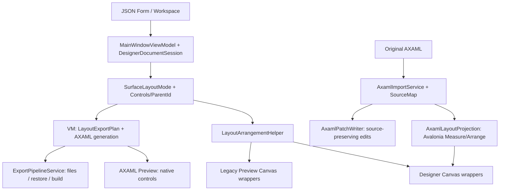
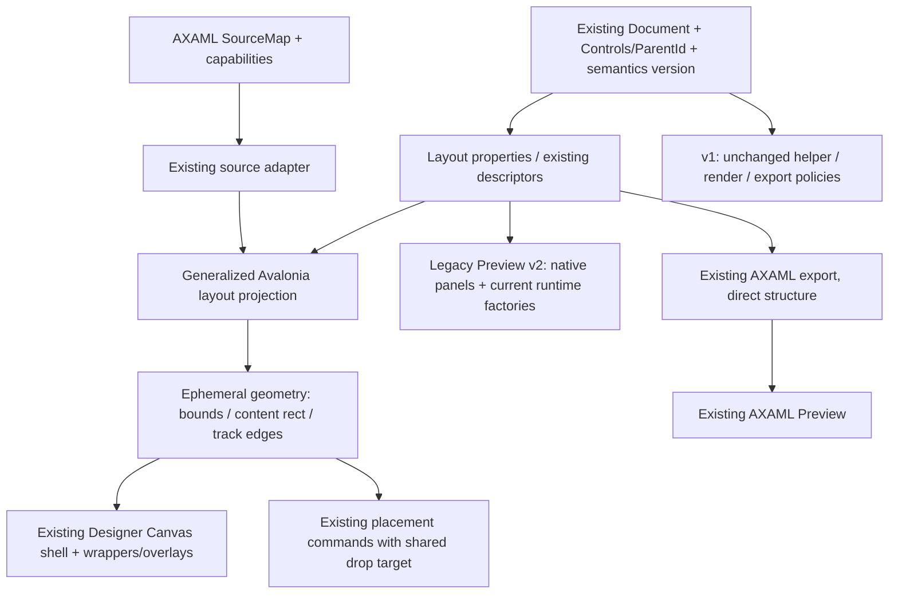

# Layout Designer Phase 1 — архитектура и план перехода

Дата: 30 октября 2026 года. Исследован checkout `c88fdd1` — после исправления ложного Selection Marquee. Документ описывает текущее поведение и предложение для согласования. Production-код на этом этапе не изменяется; Phase 2 не запущена.

## 1. Вывод и границы решения

Переход осуществим на существующей Document Model. Уже есть неявный layout root формы, плоский список controls с `ParentId`, Grid placement, определения строк/колонок, Stack order, переключение layout контейнера, базовый Grid Definition Editor и экспорт настоящих Avalonia panels. Новая иерархическая Document Model и новый layout engine не нужны.

Однако переключить значение по умолчанию с Absolute на Grid недостаточно. JSON Designer и Legacy Preview используют упрощённую геометрию, Grid hit-testing считает равные ячейки, координатные операции читают разные источники bounds, размеры контролов преимущественно фиксированы. AXAML Import уже решает часть задачи через настоящий Avalonia Measure/Arrange, но зависит от source map и ограниченного набора безопасных controls.

Рекомендуется:

1. Сохранить `SurfaceLayoutMode` как описание неявного root; не создавать обязательный root control с новым Id.
2. Обобщить существующий `AxamlLayoutProjection` для новых JSON layout-документов, используя Avalonia для измерения. Сохранить старый `LayoutArrangementHelper` для прежней семантики документов.
3. Разделить авторские layout-свойства и измеренную геометрию. Selection, hit-testing, overlays и DnD должны читать один результат измерения.
4. Явно версионировать новую layout-семантику, включая Auto-размеры. Отсутствующие новые поля должны означать прежнее поведение.
5. Сначала выпустить проверяемый Grid root как опцию новой формы. Сделать Grid стандартным шаблоном новых форм после готовности размещения по ячейкам и прохождения compatibility gates. Старые формы не конвертировать.

Canvas остаётся и пользовательским layout-режимом, и технической координатной поверхностью editor overlays. Canvas внутри редактора не обязан быть контейнером экспортируемого интерфейса.

## 2. Карта исходников и зависимостей

Номера строк относятся к исследованному commit; при реализации надёжнее искать также указанные символы.

| Узел | Реальный код и точка входа | Роль |
| --- | --- | --- |
| JSON формы | [DesignerDocumentFileModel.cs](../Models/DesignerDocumentFileModel.cs), строки 5–159 | Версия 2.3, root layout, flat controls, ParentId, Grid/Stack поля |
| Workspace / Form | [ProjectModels.cs](../Models/ProjectModels.cs), `WorkspaceModel`, `DesignerFormDocument` | Несколько форм, document snapshots, история, zoom/viewport |
| Runtime control | [DesignControlModel.cs](../Models/DesignControlModel.cs), `OnWidthChanged`, `Clone` | Observable-свойства; отдельная сериализуемая file model |
| Layout vocabulary | [DesignerLayoutModes.cs](../Models/DesignerLayoutModes.cs) | Absolute, Stack, Grid, Flex; неизвестное нормализуется в Absolute |
| Сессия | [DesignerDocumentSession.cs](../DesignerSystem/DesignerDocumentSession.cs):16 | Controls, selection, undo/redo snapshots, dirty/revision |
| Создание форм | [ProjectWorkspaceService.cs](../Services/ProjectWorkspaceService.cs), `CreateWorkspace/CreateForm`; [ProjectDocumentService.cs](../Services/ProjectDocumentService.cs), `AddForm/DuplicateForm` | Разные пути создания новых документов |
| Surface shell | [DesignerSurface.axaml](../Views/DesignerSurface.axaml), `DesignViewportRoot/DesignerCanvas`; [DesignerSurface.axaml.cs](../Views/DesignerSurface.axaml.cs) | Viewport, chrome, overlays, relay событий |
| Editor rendering | [MainWindow.axaml.cs](../Views/MainWindow.axaml.cs):2747, `RenderDesigner/AddControlsToCanvas/CreateDesignerWrapper` | Расчёт frames, wrappers, рекурсивные child Canvas |
| Старая геометрия | [LayoutArrangementHelper.cs](../Models/LayoutArrangementHelper.cs) | Упрощённые Stack/Grid/Flex frames |
| Bounds и placement | [MainWindowViewModel.cs](../ViewModels/MainWindowViewModel.cs):6595, `GetAbsolutePosition`, `FindDeepestContainerAt`, `ReparentControl`, `ApplyGridDropPlacement` | Координаты, контейнер, Grid/Stack drop |
| Interaction | [MainWindow.DesignerInteraction.cs](../Views/MainWindow.DesignerInteraction.cs); [DesignerInteraction.cs](../Models/DesignerInteraction.cs) | Режимы, capture, отмена, диагностика исправленного Marquee |
| Inspector | [MainWindowViewModel.cs](../ViewModels/MainWindowViewModel.cs):10500 и далее; [DesignerPropertyInspector.axaml](../Views/DesignerPropertyInspector.axaml) | Контекстные rows, capability, избранное, tooltips |
| Definition editor | [LayoutDefinitionEditorItem.cs](../ViewModels/LayoutDefinitionEditorItem.cs); `MainWindowViewModel.MutateGridDefinitions/RebuildLayoutDefinitionEditor`; [MainWindow.axaml](../Views/MainWindow.axaml):2990 | Уже существующие Auto/Star/Fixed, add/delete/reorder |
| Legacy Preview | [PreviewWindow.axaml.cs](../Views/PreviewWindow.axaml.cs):1212, `RenderDocument/AddControlsToCanvas`; [PreviewWindow.axaml](../Views/PreviewWindow.axaml) | Canvas и LayoutArrangementHelper, runtime controls/data |
| AXAML Preview | `MainWindowViewModel.GenerateExportedAxamlPreviewSnapshot`; `PreviewWindow.LoadExportedAxamlPreviewAsync`; [GeneratedAxamlService.cs](../Services/GeneratedAxamlService.cs) | Клон для export generation, runtime AXAML loader, actual native controls |
| Layout export | `MainWindowViewModel.BuildLayoutExportPlan`:15322, `PlacementAttributes`:19873, `AppendRootContainerOpening`:19920, `AppendLayoutHostOpening`:20002 | Реальная генерация контейнеров находится преимущественно в VM |
| Export packaging | [ExportPipelineService.cs](../Services/ExportPipelineService.cs) | Файлы, manifest, restore/build validation; не layout engine |
| Import layout | [AxamlImportService.cs](../DesignerSystem/AxamlRoundTrip/AxamlImportService.cs); [AxamlControlMetadata.cs](../DesignerSystem/AxamlRoundTrip/AxamlControlMetadata.cs) | Source tree → ParentId, capabilities, сохранённый исходный тип |
| Native layout | [AxamlLayoutProjection.cs](../DesignerSystem/AxamlRoundTrip/AxamlLayoutProjection.cs):16 | Безопасное временное Avalonia tree, Measure/Arrange, local bounds |
| Round-trip | [AxamlPatchWriter.cs](../DesignerSystem/AxamlRoundTrip/AxamlPatchWriter.cs) | Минимальные source edits; блокировки структурных изменений |
| Metadata / plugins | [DesignerContracts.cs](../PluginContracts/DesignerContracts.cs):255; [BuiltInControlRegistrar.cs](../DesignerSystem/BuiltIn/BuiltInControlRegistrar.cs):141 | Descriptor уже знает container/children/layout и BuildPreview/AppendXaml |
| Plugin placement | [EremexDataGridControlDescriptor.cs](../Plugins/EremexDesignerPlugin/Descriptors/EremexDataGridControlDescriptor.cs):263; [EremexTextEditorDescriptor.cs](../Plugins/EremexDesignerPlugin/Descriptors/EremexTextEditorDescriptor.cs), `AppendXaml` | Собственные fixed sizes и Canvas attributes, минуя общий PlacementAttributes |
| Diagnostics | [DocumentDiagnosticsService.cs](../Services/DocumentDiagnosticsService.cs), `ValidateLayoutUsage` | Grid bounds/spans, Stack order и применение layout |
| VS host | [VsHostWindow.cs](../AvaloniaDesigner.VsHost/VsHostWindow.cs); [VsHostBridge.cs](../AvaloniaDesigner.VsHost/VsHostBridge.cs) | Window наследует MainWindow; HostBuffer persistence, shared Surface |

Текущие пути:

Стрелка в LegacyGeometry не означает native layout: helper возвращает Rect, а настоящие panels там не размещают детей. Также совпадение Designer и Legacy Preview между собой не доказывает совпадение с exported application.

## 3. Возможности Document Model, ParentId и Children

**Root.** `DesignerDocumentFileModel.SurfaceLayoutMode` уже допускает Grid. Его definitions хранятся в `SurfaceGridRowDefinitions/SurfaceGridColumnDefinitions`, а число строк/колонок — в `SurfaceLayoutRows/SurfaceLayoutColumns`. Root children определяются пустым ParentId. Экспорт умеет вывести `<Grid x:Name="RootLayout">` без специальной записи root в Controls.

**Вложенность.** `DesignerControlModel` и file model содержат `ParentId`, `ChildLayoutMode`, `LayoutOrientation`, `LayoutSpacing`, `Rows/Columns`, definitions. Отдельной сериализуемой коллекции Children нет: `GetChildControls(parentId)` выбирает детей из общей коллекции. Рендер и export рекурсивны; модель не предполагает только один уровень вложенности. Не следует заводить вторую коллекцию Children, требующую синхронизации с ParentId.

**Placement.** Есть `GridRow`, `GridColumn`, `GridRowSpan`, `GridColumnSpan`, `StackOrder`, `Margin`, Horizontal/VerticalAlignment, числовые Width/Height, X/Y, anchors. `ReparentControl` предотвращает перенос в самого себя/потомка и меняет размещение по типу родителя. Новый placement должен дополнительно проверять существование родителя, допустимость children, циклы в загруженном дереве, session/document и допустимость single-content контейнера. Проверка во время reparent не является полной валидацией произвольного JSON.

**Порядок и ZIndex.** Самостоятельного поля ZIndex в основных control/file models нет. Absolute siblings сортируются с эвристикой background Border, затем по исходному порядку коллекции; `GetCanvasVisualZIndex` возвращает индекс. Stack сортируется по StackOrder и исходному индексу. Для Grid/Flex используется порядок детей в коллекции. При импорте учитываются source order и Canvas.ZIndex, исходник сохраняется отдельно. Нельзя считать StackOrder универсальным ZIndex. Для native Grid перекрывающиеся controls должны сохранять детерминированный sibling order; независимый редактор ZIndex не нужен для первой версии.

**Сериализация.** Есть ручные `ToControlFileModel/FromControlFileModel`, `CreateDocumentFileModel/ApplyDocument`, clone, Preview file-model copies, clipboard/template paths, workspace snapshots и secondary-form export. Новое persisted-свойство должно пройти все эти пути. `DuplicateForm` уже переназначает Id и ParentId. Измеренные bounds и drag targets сериализовать не надо.

**Сессия.** DesignerDocumentSession подходит без замены: layout-команды меняют те же controls и document, selection остаётся по ControlId. Persisted root settings пока проходят через VM и сохраняются в document snapshot. Новые поля root также должны быть per-form, а не глобальной настройкой активного окна.

## 4. Canvas-specific dependencies DesignerSurface

| Зависимость | Что делает сейчас | Что требуется для новой семантики |
| --- | --- | --- |
| `DesignerSurface.axaml` | Три Canvas для viewport/host/content, отдельные guide/selection overlays | Сохранить editor shell. Отделить его от logical root формы |
| `RenderDesigner` | Очищает/rebuild Canvas children и `_wrapperByControlId`; source bounds рассчитываются только для AXAML | Для нового JSON получать native snapshot, не перестраивать capture owner посреди gesture |
| `AddControlsToCanvas` | Absolute читает X/Y; остальное вызывает helper; AXAML читает measured bounds | Выбор renderer/geometry по document semantics, не только SurfaceLayoutMode |
| `CreateDesignerWrapper` | Фиксированные Width/Height, внутренний root Canvas, child-host Canvas, resize grip | Для editor брать размеры из snapshot; не навязывать измеренному control авторские fixed sizes повторно |
| `GetAbsolutePosition` в VM | Для JSON суммирует X/Y предков; для AXAML использует local measured frames | Новый JSON должен использовать measured hierarchy и content offsets |
| `GetAbsoluteBounds` в View | Сначала TranslatePoint реального wrapper; fallback к VM/model | Один snapshot должен покрывать и VM hit-test, и overlays, включая первый layout pass |
| `FindDeepestContainerAt` | Model Width/Height + absolute position, максимальная глубина | Actual bounds/content rect, видимость/clipping, порядок перекрытия и исключение dragged subtree |
| Move | Изменяет X/Y только при Absolute parent, но затем снова пишет Canvas.Left/Top wrapper из active.X/Y | Layout move показывает ghost/target; не переносит wrapper к 0,0 из model X/Y |
| Resize | Дельта → fixed Width/Height, clamp 40×24 и parent size минус model X/Y | Явная политика Auto/Fixed и constraints по content/cell bounds |
| Guides / grouping / arrange | Смешивают wrapper bounds и model coordinates; группировка вычисляет bounding box | Проверить align/distribute/group/ungroup/copy/paste/nudge по layout parent; не применять absolute-команду молча |
| Minimap / zoom | Host coordinates, ScaleTransform, chrome offset, scroll translation | Сохранить преобразование в design DIP; проверить nested content offsets на 25/100/200% |
| Marquee | Пересечение measured wrappers, исключение выбранных descendants; start требует Source и hit-test самого Canvas | Сохранить guards и capture. Новые grid guides не должны перехватывать hit-test пустой области |

Не все controls лежат непосредственно на root Canvas: рекурсивные child Canvas уже есть. Проблема — зависимость многих операций от координатной модели этих Canvas, а не отсутствие дерева.

Числовой пример из статического анализа: при высоте 600, двух строках, definitions `80,*` и spacing 12 старый helper размещает вторую строку с Y=306. Native Grid с этими definitions начинает вторую строку с Y=80. `ApplyGridDropPlacement` делит высоту пополам и считает Y=100 первой строкой. Это три разных ответа для одного описания. Пример выведен из формул кода, не является выполненным runtime-тестом будущего Layout Designer.

## 5. Текущая поддержка Grid и её пределы

Работают хранение definitions и attached placement, built-in Grid descriptor, root Grid export, nested Grid export и импорт Grid с native measurement. Уже есть команды add/delete/reorder definitions, нормализация размещения детей при удалении строки/колонки, выбор active host и overlay toolbar.

В JSON geometry `LayoutArrangementHelper.ChildSnapshot` вообще не принимает definitions, Margin или alignments. Grid делится на равные cells, число строк может дополнительно увеличиваться от количества children, размеры ограничиваются фиксированным desired size и минимумом 40×24. Реальный Avalonia Grid может держать несколько детей в одной ячейке; количество детей не должно добавлять строки автоматически в новой семантике.

Кроме того, `DocumentDiagnosticsService.ValidateLayoutUsage` проверяет Grid placement по числовым Rows/Columns, а exporter отдаёт приоритет непустой строке definitions. Поэтому значения счётчиков и explicit definitions должны иметь один источник истины для validation, hit-testing и export; простого добавления более удобного редактора недостаточно.

Grid definition parser/editor тоже требует стабилизации: `Math.Max(1, value)` меняет `0.5*` в `1*` и нулевой fixed track в 1; неизвестный токен превращается в `*`. Нельзя объявлять текущую строковую поддержку полной поддержкой Avalonia GridLength. Нужно валидировать finite/nonnegative значения и сообщать об ошибке без молчаливого изменения документа. Property-element definitions с MinWidth/MinHeight поддержаны в source projection частично, но не представлены полноценно в JSON editor.

## 6. Drag & Drop: существующее и требуемое

Текущая цепочка: `ToolboxItem_PointerPressed` → системный DoDragDrop → Canvas DragOver/Drop → `FindDeepestContainerAt` → `TryCreateControlFromToolboxDrop` → Grid/Stack/Absolute placement. Target document уже проверяется. При перемещении существующего компонента Release делает reparent только для одного selected root; multi-drag в layout не имеет полноценного группового placement.

Недостатки:

- Grid hint и commit используют разные вычисления: hint берёт pointer, placement добавляет половину model Width/Height; оба делят на равные tracks. Borders, padding, definitions и фактическое размещение не согласованы.
- Stack insertion сопоставляет pointer с model X/Y и Width/Height siblings; после layout X/Y часто равны нулю. Визуальная подсказка в View при этом берёт wrapper bounds. Hint и commit могут расходиться.
- Flex/Wrap не имеет полноценной insertion policy по строкам; Dock placement в JSON отсутствует.
- Deepest-container поиск не решает пересечение siblings одинаковой глубины, hidden/clipped containers и полный запрет dragged subtree.
- Layout child нельзя «двигать» через Canvas nudge. Для AXAML `CanMoveAxamlControl` дополнительно запрещает движение Grid child, поскольку проверяет именно Canvas.Left/Top capability.

Предлагаемое поведение:

| Родитель | Preview во время drag | Commit |
| --- | --- | --- |
| Canvas / Absolute | Существующий свободный drag и snapping | ParentId + локальные X/Y |
| Grid | Подсветка actual cell/span из native track intervals | ParentId + Row/Column/Spans; X/Y не являются placement |
| StackPanel | Линия вставки по measured bounds и orientation | ParentId + нормализованный StackOrder |
| WrapPanel | Insertion по actual wrapped lines и sibling order | ParentId + явно определённый order |
| DockPanel | Подсказка стороны; отдельный last-child fill target | ParentId + Dock и sibling order |

Один временный `LayoutDropTarget` должен использоваться и для hint, и для commit. В нём достаточно DocumentId, container Id либо root, layout kind, cell/spans или insertion index/dock, local point, geometry revision. Не нужен второй drag controller.

Existing interaction mode `MovingControl` можно использовать и для layout drag; хранить разный payload жеста. Исключение одновременно активных Move/Resize/Marquee и явное владение capture сохраняются. Отсутствующий/устаревший target, смена формы, Escape и потеря capture отменяют pending placement. Layout drag лучше применять в модели один раз на Release, чтобы отмена не требовала отката нескольких ParentId/StackOrder mutations.

Для multi-selection сначала поддержать перенос contiguous siblings с одним родителем как атомарную операцию. Для mixed parents / неоднозначного Grid-span placement — явная недоступность действия с объяснением; не делать молчаливый no-op или перенос только одного из выбранных.

## 7. Resize и размеры

Основная модель хранит только double Width/Height. JSON control ограничивается снизу 40×24; `UsesSourceLayout` снимает это ограничение для импортированной разметки. При импорте отсутствие Width/Height сохраняется в SourceMap, а projection не выставляет эти свойства, если их не было и они не менялись. JSON такого признака не хранит. Использовать NaN как persisted Auto нельзя: текущая JSON-конфигурация не задаёт специальный number handling, и это не решает отличия authoring size от arranged size.

Минимальное расширение для новой семантики: отдельный режим `WidthMode/HeightMode = Fixed | Auto` при сохранении существующих числовых Width/Height как fixed value/design hint. Stretch определяется существующим Horizontal/VerticalAlignment, а не третьим независимым sizing engine. Отсутствие режима означает Fixed для старых файлов. Нативные Min/Max constraints можно хранить через уже имеющиеся CustomProperties с типизированными editor adapters; их сериализация уже есть. Не смешивать minimum selection hit area с реальным MinWidth/MinHeight элемента.

Политика resize должна быть утверждена до включения Grid default:

- Control resize меняет только выбранные размеры, осознанно переводя соответствующую ось Auto → Fixed; Row/Column не меняет.
- Track resize в Grid Editor — другой тип жеста: изменяет RowDefinitions/ColumnDefinitions, а не Width всех детей.
- Stretch/Auto control получает bounds от layout, а не от model Width. Restore Auto доступен из Inspector.
- Ограничение считается по actual cell/content geometry; Canvas snapping действует в Canvas. Layout resize не должен наследовать произвольную сетку absolute coordinates.
- Один жест — один undo batch, capture остаётся на текущем grip до завершения. Для перерисовки новой геометрии нельзя удалять захвативший pointer wrapper.

## 8. Property Inspector и Grid Definition Editor

| Свойство | Текущее состояние | Доработка |
| --- | --- | --- |
| Margin | Строка Thickness, Inspector и export есть | Редактор 1/2/4 значений с валидацией; применить при измерении нового JSON |
| Padding | Одно double, некоторые controls поддерживают; не универсальное свойство любого Panel | Uniform сохраняется для legacy; для native layout учитывать допустимого владельца и Border decorator, при необходимости Thickness в CustomProperties |
| Horizontal/VerticalAlignment | Есть enum editors, сериализация и export | Связать с Auto/Fixed и actual bounds |
| Grid.Row/Column/Spans | Есть поля и conditional rows в `layoutOnly` ветке Inspector | Базовые attached editors перенести в обычный контекст уже в Phase 2; limits брать из definitions |
| Row/ColumnDefinitions | Есть строки и отдельные коллекции editor items | Переиспользовать существующий editor; добавить canvas rulers/track handles, строгую проверку и preview |
| Orientation / Spacing | Есть для Stack/Flex, editor/commands/export | Нативная семантика для нового режима; Spacing Stack не дублировать child margin |
| Stack order | Есть поле, команды ↑/↓ | Измеренные insertion targets, atomic reorder/undo |
| DockPanel.Dock / LastChildFill | Нативная source projection читает их из оригинала; полноценных JSON editors нет | Built-in Dock descriptor + typed CustomProperties; contextual enum/bool editors |
| Auto Width/Height | Только через отсутствие source attributes в AXAML | Явные mode editors для нового JSON |

Основные layout fields не отсутствуют из-за скрытой вкладки Layout: `BuildPropertyGridRows` уже выдаёт X/Y/Margin/Alignment и при отключённом experimental Layout tab. Но attached Grid rows и часть container editing находятся в `layoutOnly` ветке; нельзя откладывать весь Inspector до Phase 6.

У существующего Grid Definition Editor есть add/delete/reorder и Auto/Star/Fixed, однако он привязан к active host и отдельным bindings MainWindow, а не законченному визуальному track editor. Перед изменением active selection редактирование должно фиксироваться/отменяться в исходном host, а не применяться к новому. Reorder track со spanning children требует явной политики: простая перестановка начальных индексов не гарантирует сохранение смысла диапазона. Delete должен пересчитать пересекающиеся spans как часть той же undo-команды.

Повторно использовать PropertyGridRowViewModel, tooltip descriptions, favorites, category/search и live gesture batching. Не создавать независимую панель свойств. Для source-backed значений соблюдать `CanEditAxamlProperty`; не заменять bindings/неизвестные значения литералами ради редактора.

## 9. Preview: два разных пути

**Legacy Preview.** `PreviewCanvas` и `CreatePreviewWrapper` содержат рекурсивные Canvas, а Stack/Grid/Flex frames считаются тем же helper. SizeChanged планирует новый RenderDocument, но наличие resize handler не превращает helper в нативный layout. Definitions, alignments и margins не входят в его расчёт; Canvas остаётся с исходными координатами. Есть исходный минимальный размер поверхности. Основные runtime data/Logic находятся отдельно в PreviewRuntimeService/context и соответствующих partial files — их следует сохранить.

**AXAML Preview.** Создаётся export clone, выполняется GenerateXaml, generated Window преобразуется в runtime root, loader создаёт реальные controls, `PreviewSurfaceBorder.Child` заменяется на полученный content. Нативные Grid/Stack/Wrap выполняют layout. Но ошибки генерации фиксированных размеров, отступов и выбранного export mode сохраняются: AXAML Preview — проверка результата export, не независимая реализация правильного layout.

Для новой JSON semantics Legacy Preview должен получать настоящий native tree из обобщённой layout-проекции/существующих runtime factories, с тем же mapping layout attributes. Одной смены координат Rect недостаточно для Auto content, ScrollViewer, виртуализации и интерактивных controls. Старые документы продолжают идти прежним путём.

DataGrid и Eremex сохраняют существующие BindingSource, DataContext, ItemsSource, async/cancellation/error paths и diagnostics. Layout layer получает готовые данные/коллекции через существующие factories, не запускает SQL при Measure. После изменения данных/текста/visibility layout инвалидируется на UI thread. Нужны конечные размеры viewport: DataGrid в Auto/Stack/ScrollViewer может потерять виртуализацию при бесконечном измерении. Это отдельный runtime acceptance test, не string assertion.

## 10. Export: реальный layout и experimental responsive export

Реальные layout structure и experimental export уже различаются в коде:

1. При обычном `Canvas layout` export `BuildLayoutExportPlan` фактически уважает `SurfaceLayoutMode`: Grid → настоящий Grid, Stack → StackPanel, Flex → WrapPanel. Название настройки вводит в заблуждение, но не заставляет все формы экспортироваться Canvas.
2. `Responsive layout (experimental)` сортирует roots по Y/X, оценивает gaps/margin, выдаёт StackPanel либо Canvas fallback. Вложенные controls, plugin controls и вертикальные пересечения вызывают fallback. Document Model при этом не меняется. Этот режим не является базой Layout Designer.
3. Nested export использует descriptor/bridge, `AppendLayoutHostOpening`, `AppendInnerLayoutHostOpening` и рекурсивный child appender. Border получает inner panel, Group может стать panel выбранного режима.
4. C# export — преимущественно code-behind/ViewModel к сгенерированному AXAML (`InitializeComponent`), а не независимый второй конструктор всего layout tree. Дополнительно генерируются anchors для Absolute controls с AnchorRight/Bottom; layout controls не должны попасть в этот путь.

Блокирующие места:

- `SizeAttributes` всегда пишет Width/Height. Root в обычном немониторном размере также получает fixed dimensions; stretch используется в managed-window ветке. Поэтому Grid root сам по себе ещё не обеспечивает resize окна.
- `PlacementAttributes` для Stack при отсутствии explicit margin может добавлять child margin для spacing, тогда как сам StackPanel уже имеет Spacing. По коду возможен двойной зазор. Для новой семантики spacing должен применяться ровно один раз; legacy вывод не менять молча.
- Grid/Flex spacing выражается fallback margin, тогда как helper считает gaps в геометрии tracks/переноса. Нужно единое правило: для Phase 2 native Grid spacing=0, пользовательские отступы через Margin/Border; старый spacing остаётся legacy policy. Дальнейший Grid gap — отдельная явно описанная возможность.
- JSON DockPanel не представлен полноценным built-in type/layout mode. Import alias Group не позволяет регенерировать исходный DockPanel из JSON без SourceMap.
- Опция experimental responsive сейчас выбирается независимо от native structure. Для новой семантики она должна быть недоступна/неприменима: экспортировать сохранённое дерево без эвристики и Canvas fallback. Не переписывать legacy responsive exporter в рамках этой задачи.
- DataGrid с filter/group panel экспортируется через внешний Grid host. Attached placement должен применяться к этому внешнему элементу, а не случайно к внутреннему DataGrid. Plugin root имеет аналогичный риск.
- **Eremex — отдельный blocker, а не только риск Auto-measure.** `EremexDataGridControlDescriptor.AppendXaml` и TextEditor descriptor напрямую пишут Width/Height и Canvas.Left/Top; общего `PlacementAttributes` они не вызывают. BuildPreview также задаёт свои fixed sizes, у DataGrid есть дополнительные минимумы. Одна правка built-in exporter не обеспечит Grid.Row/Column/Spans, Stretch и Auto для этих controls.

Новый AXAML обязан отражать ParentId/definitions/placement напрямую. ExportPipelineService, required-package resolution, data loaders и multi-form generation не требуют замены; изменения сосредоточатся в mapping layout attributes/size/root и consumer-ах snapshot. Названия экспортных режимов можно уточнить отдельно от смены сериализованных значений настроек.

В v2 нельзя молча игнорировать ненулевой Grid LayoutSpacing: до появления согласованного gap-контракта editor должен исключать эту настройку для native Grid, а загрузка такого значения — выдавать диагностику. Это ограничение нового режима, а не изменение legacy Grid spacing.

Минимальный путь для Eremex в будущем: общий host вычисляет placement/sizing payload для v2; in-repo descriptors потребляют его через существующий `IDesignControlNode.BuiltInProperties`/existing context вместо собственных Canvas attributes. Точный ключ payload — внутренняя договорённость реализации 2A, не новое свойство пользователя или JSON. Без payload сохраняется прежний вывод. Для Preview host применяет согласованные size/layout properties к возвращённому native control перед Measure. Нужны узкие изменения glue-кода двух descriptors, без обновления Eremex NuGet, изменения data logic, ABI существующих interfaces и IPC. Нельзя обходить это постобработкой всего AXAML регулярными выражениями. Неизвестные third-party descriptors без такого соглашения не получают обещания native Auto/placement: нужен диагностируемый ограниченный режим и отдельная проверка.

## 11. Что переиспользовать из AXAML Import / Round-trip

`AxamlLayoutProjection` уже строит безопасное временное дерево Grid, StackPanel, DockPanel, WrapPanel, Canvas и других поддержанных containers; вызывает Measure/Arrange; возвращает bounds относительно родителя. Он учитывает literal definitions/constraints, Auto content, dock, часть template/scroll semantics. Это основа общей layout-проекции, не повод создавать ещё один арифметический engine.

Необходимое обобщение ограничено:

- Source-specific чтение, capabilities и snapshot comparisons остаются в AXAML adapter.
- Для JSON свойства поступают из existing models/descriptors; Grid/Stack/Wrap/Dock создаются настоящими panels, а не декоративными previews контейнеров.
- Расширить результат измерения actual bounds/content rect и фактическими track edges. Пока возвращается только словарь control Rect; его недостаточно для корректного Grid cell hit-testing.
- Leaf factory должна покрыть реальные built-in/plugin controls через существующие preview contracts. Текущая source projection не является универсальным renderer: для неподдержанных leaf types есть TextBlock fallback, imported styles/resources намеренно не исполняются. Нельзя обещать точный Eremex/DataGrid Auto-measure лишь на основании текущего projection.
- Явно разделить approximate/placeholder measurement и точное native measurement в diagnostics и тестах.

Важно сохранить ограничения round-trip. DockPanel/Canvas/часть других импортированных controls представлены Group alias; настоящий тип хранится в SourceMap. `AxamlPatchWriter` блокирует ParentId/type/ChildLayoutMode changes, reorder в ordered panels, nested insertion и вмешательство в opaque properties. Доступная вставка ограничена поддержанными controls в безопасный root Canvas. Наличие импортированного дерева не означает поддержку его произвольного структурного редактирования.

В Phases 2–7 JSON получает новые возможности, AXAML продолжает действовать по существующей capability matrix. Доступные literal Grid attached properties и definitions можно редактировать существующими patches. Reparent/reorder/замена root/imported definition property elements не включаются автоматически. Их расширение требует отдельной согласованной задачи с source-span tests и ACK/rebase/version/checksum проверками; полная регенерация файла запрещена.

## 12. Обратная совместимость и минимальные persisted changes

**Не менять defaults DTO на Grid.** Сейчас отсутствие `SurfaceLayoutMode` означает Absolute. Замена initializer в `DesignerDocumentFileModel` переинтерпретирует старые JSON. Новый default задаётся только в явном создании новой формы/проекта; `WrapSingleDocument`, load, recovery, duplicate и импорт существующего файла не являются созданием Grid-формы.

Существующие старые Grid/Stack/Flex документы также нуждаются в сохранении поведения: глобальная подмена helper на native measurement изменит их размер/spacing. Предлагается следующая совместимость:

| Поле / правило | Старый документ, поля нет | Новая layout-форма |
| --- | --- | --- |
| `SurfaceLayoutMode` | Absolute по текущему правилу | Grid, заданный factory новой формы |
| Предлагаемый `LayoutSemanticsVersion` | 1: существующие render/spacing/size policies | 2: native geometry и явное sizing |
| Предлагаемые `WidthMode/HeightMode` | Fixed | Auto или Fixed по шаблону контрола; не выводить Auto из нулевого размера |
| Definitions / attached properties | Текущие поля сохраняются | Те же поля, строгая проверка; счётчики согласованы со строками definitions |
| Canvas subtree | Текущее поведение для v1 | Настоящие Canvas semantics внутри v2; явные локальные coordinates и существующий anchor contract |
| Measured geometry / selection / drop target | Не сериализуются | Не сериализуются |

`LayoutSemanticsVersion` оправдан реальным изменением поведения, а не новым названием режима. Это предложение, поля пока не добавлены. Новые Mode fields можно добавить в existing control/file models, не вводя новую Document Model. Dock/LastChildFill и дополнительные constraints — через typed accessors к существующим CustomProperties, если не потребуется доказанное специальное поле.

Для документа с новой семантикой разумна schema version `2.4` после утверждения схемы; текущий `Version="2.3"` сам по себе не является работающим migration gate. В проверенных load paths явной маршрутизации по версии нет, а `CreateDocumentFileModel` заново создаёт DTO с default Version. Нужны сохранение версии при snapshots/copies, валидация поддержанной semantics version и запрет тихого downgrade при save. Два разных числа имеют разный смысл: schema version описывает допустимые поля; semantics version — поведение renderer/export.

Это версия документа формы; `WorkspaceModel.Version="1.0"` описывает отдельную оболочку workspace и не требует автоматического изменения только из-за новых полей формы.

Гарантия: новая версия Designer читает старые Canvas/experimental-layout проекты без изменения их структуры и поведения. Гарантировать редактирование нового v2 документа старым бинарником нельзя: неизвестные поля могут быть потеряны. Это нужно указать в формате/UX. Обратная конвертация Grid → Canvas — только отдельная явная команда с резервной копией и фиксированным viewport, не операция Save/Load.

## 13. Предлагаемая минимальная архитектура

| Предложенный элемент | Решение |
| --- | --- |
| LayoutRoot | Не добавлять persisted root Id/новую модель: root уже описан SurfaceLayout* и пустым ParentId. Во внутренних вызовах явно отличать root от отсутствующего контейнера |
| LayoutContainerDescriptor | Новая публичная иерархия не нужна. Использовать IControlDescriptor + existing source metadata; небольшой внутренний адаптер допустим. Не менять PluginContracts/IPC ради layout |
| Layout snapshot | Нужен неперсистентный результат native measurement: local/absolute bounds, content rect, track intervals, document/session/generation и viewport. Обобщить AxamlLayoutBounds |
| LayoutPlacementService | Отдельная большая система не нужна. Свести существующие ApplyGridDropPlacement/ApplyStackDropOrder/ReparentControl к одному месту; небольшой внутренний helper только для устранения дублирования View/VM |
| GridCellHitTesting | Нужна функция по actual track intervals из snapshot, а не ещё один вычислитель GridLength. Возвращает один общий LayoutDropTarget |
| LayoutDropTarget | Небольшая временная запись нужна для совпадения hint/commit и проверки revision/document |
| LayoutPropertyEditor | Развить существующий Property Inspector и LayoutDefinitionEditorItem. Полностью новая панель не нужна |

Snapshot принадлежит открытой сессии/её view-state и не переносится между формами. Cache key включает document/session generation, viewport size, layout properties/order/content/theme изменения. `DesignerDocumentSession.Revision` нельзя без проверки считать достаточным ключом для каждого live property change: изменение control и обновление persisted Document происходят в разных точках. Не вычислять полное дерево на каждый PointerMoved; reuse snapshot, делать target hit-test, а после mutation/resize инвалидировать измерение. Measure/Arrange и публикация bounds выполняются на UI thread. Асинхронные результаты данных старой сессии не обновляют геометрию новой.

Editor может пока отображать wrappers на Canvas по native bounds, как уже делает AXAML projection. Такой Canvas — инструмент selection/overlays; runtime root остаётся настоящим Grid. Legacy Preview v2 должен строить native panels с реальными runtime controls, чтобы интерактивное поведение и responsive layout не зависели от ещё одной координатной симуляции.

## 14. Поэтапный план, объём и acceptance gates

Оценки — предварительные человеко-дни одного разработчика, включая тесты и review, без массового рефакторинга MainWindow и без расширения source-preserving structural editing. Это оценка объёма, не календарное обязательство.

| Этап | Сложность / оценка | Конкретный результат и критерий |
| --- | --- | --- |
| Phase 1 — текущий анализ | Средняя; завершение этим отчётом | Карта зависимостей, контракт совместимости и план; никаких новых production defaults |
| Phase 2 — Native Grid root, opt-in | Высокая, 10–15 дней | См. 2A/2B ниже, включая узкий plugin placement adapter. Новая JSON-форма с Grid root, native sizing, JSON round-trip, обе Preview и Export. Старые проекты идут прежним путём |
| Phase 3 — Grid Definition Editor | Средняя/высокая, 4–6 дней | Развить существующие editor items/commands: visual tracks, Auto/*/px, add/delete/reorder, span policy, ошибки и undo. Actual track boundaries совпадают с preview/export |
| Phase 4 — Grid Drag & Drop | Высокая, 6–10 дней | Один target для hint/commit, actual cells, spans, reparent, single gesture undo, escape/capture/form switch. После gates разрешить Grid как default новых форм |
| Phase 5 — Nested Layouts | Высокая, 6–10 дней | Завершить native nested JSON + placement, Stack insertion/order, Wrap line insertion, built-in DockPanel/Dock/LastChildFill, Canvas subtree; cardinality и cycle validation |
| Phase 6 — полный Layout Inspector | Средняя, 3–5 дней | Thickness/constraints/contextual editors, multi-selection, mixed values, favorites и tooltips, editing transaction при смене active host. Базовые Auto/Grid placement editors уже сделаны в Phase 2 |
| Phase 7 — Responsive validation | Высокая, 5–8 дней | Сравнение actual bounds и runtime behaviour на разных размерах/DPI, controls/plugins/data, оба host, legacy compatibility. Документированные ограничения вместо ложной адаптивности |

Будущий объём Phases 2–7: ориентировочно **34–54 человеко-дня**, резерв около 25% на несовпадения templates/plugins/virtualization. Расширение structural AXAML patches, автоматическая миграция старых форм, SharedSizeGroup/resources/binding evaluation и полноценный constraints editor с drag rules в эту оценку не входят.

**Phase 2A — контракт и безопасный native measurement.** Утвердить semantics/schema/sizing defaults; сохранить v1 путь. Обобщить существующую проекцию и результат, создать native Grid root через existing factory, подключить basic actual geometry и UI-thread invalidation. Согласовать размеры корня и preview viewport. Проверить на простом Button/TextBox без данных, в том числе Auto/Stretch и явный Fixed. Поддержанные панели строятся одним native механизмом; не создавать искусственные X/Y для Grid детей.

**Phase 2B — вертикальный срез.** Подключить новую семантику к JSON load/save/clone/recovery/secondary export, обычному Inspector, Legacy Preview и AXAML generator. Для новой формы — один `*` row и один `*` column, Grid spacing=0; больше tracks добавляются явно. Два элемента в одной ячейке допустимы по Grid semantics, но UI должен показывать это, а не автоматически превращать Grid в Stack. Проверить Standard DataGrid и in-repo Eremex descriptors как child Grid, placement/size adapter, runtime binding и resize окна. Новая форма создаётся как явный новый шаблон; глобальное включение default откладывается до Phase 4. Не менять default initializer при десериализации.

**Планируемая зона файлов Phase 2:** existing model/file model, VM mapping и root factory paths; AxamlLayoutProjection и тонкий JSON adapter; MainWindow rendering/bounds consumers; PreviewWindow; VM size/root/placement exporters; два Eremex descriptors и общий placement payload adapter; basic Inspector rows; tests. Grid ruler/DnD и Dock расширяются последующими PR. Export packaging, SQL adapters и VSIX bridge не должны потребовать новых протоколов или зависимостей. Точный набор классов проверяется при реализации 2A; это не разрешение начать её сейчас.

## 15. Риски и regression strategy

| Риск | Уровень | Обязательное предотвращение |
| --- | --- | --- |
| Изменение старого JSON из-за нового default / renderer | Критический | DTO defaults Absolute/v1/Fixed; отдельная new-form factory; golden legacy fixtures с nested Grid/Stack тоже |
| Возврат ложного Marquee | Критический | Сохранить explicit capture owner, threshold 4 DIP и handled/source guards. Проверять пустую Grid cell с декоративным overlay через native input |
| Данные есть, DataGrid пуст из-за нового wrapper/DataContext | Критический | Проверять ItemsSource и реальные cell values, DataView paths, пустую таблицу и ошибки в обоих Preview; не заменять данные samples |
| Geometry mismatch View/VM/export | Высокий | Один measured snapshot; тесты actual bounds, не только наличие Grid.Row в строке AXAML |
| Auto/Stretch и Fixed начинают конфликтовать | Высокий | Explicit size mode и finite constraints; measured bounds не записываются в Width автоматически |
| Перестройка удаляет captured visual | Высокий | Стабильный owner на время gesture, отмена при смене документа, исключение устаревших targets |
| Multi Form наследует geometry/root/connection другой формы | Высокий | Per-form persisted settings + per-session transient snapshot; вторичные формы export/load тестируются отдельно |
| Undo/Redo распадается на множество промежуточных состояний | Высокий | Один gesture/definition mutation/reparent → одна transaction; отмена без partial tree changes; snapshots включают новые поля |
| Source-проекция ошибочно становится JSON-перегенерацией AXAML | Критический | DocumentKind/capability gates, неизменный patch writer и opaque source preservation |
| Авторазмеры plugin controls зависят от styles/templates | Высокий | Реальные Eremex factories/styles и измерения; явная диагностика approximate placeholder; никаких плагинов в devenv.exe |
| Plugin AppendXaml обходит общий layout exporter | Критический | Отдельный v2 placement/size payload для in-repo Eremex descriptors, legacy fallback и runtime tests; неизвестные plugins не считать автоматически совместимыми |
| Row/column reorder ломает spans / Dock fill | Высокий | Atomic index/span/order policy и fixtures с пересечением диапазонов |
| Потеря производительности / DataGrid virtualization | Высокий | Конечный viewport, snapshot reuse, измерение только после invalidation, UI responsiveness / collection update tests |
| VS host работает иначе standalone | Средний/высокий | Тот же Surface/controller/session, HostBuffer source patches и ACK/rebase; без изменения IPC |

Предлагаемая матрица новых regression checks:

1. Старые single-document и workspace JSON без новых полей: open/edit/save/reopen, Canvas coordinates/order/anchors, nested Grid/Stack/Flex, обе Preview и export остаются прежними.
2. Новая форма имеет Grid semantics v2; loaded/duplicated/recovered старая форма не меняет режим. Unknown schema/semantics version даёт понятную ошибку без downgrade/save.
3. Root Grid с `Auto,*`, `100,2*,*`, `0.5*`, fixed/нулевыми tracks и spans; invalid/NaN/negative tokens не меняют документ. Counts и definitions согласованы.
4. Для заданного viewport сравнить actual bounds Designer projection, Legacy native Preview, AXAML Preview и запущенного generated application с допуском в DIP. Отдельно Insets, Border padding/thickness, Margin и alignments.
5. Два размера окна, например 600×400 и 1100×700: Auto header и `*` DataGrid row растут правильно; явный Fixed остаётся fixed; Canvas child сохраняет свой контракт. Различать Window outer size и ClientSize.
6. Grid DnD по неравным tracks, попадание на border/gap, empty cells, spans, перенос между root/nested Canvas/Grid, исключение descendants/cycles, overlapping siblings и locked/hidden targets.
7. Stack/Wrap/Dock: measured insertion order, разные Orientation, wrapping after resize, LastChildFill true/false, явно заданный Dock и последний ребёнок.
8. Selection/Inspector: repeated click, Ctrl/Shift, multi-selection, zero-size/Auto content hit target, вложенные wrappers, favorites и tooltip descriptions, сохранение active host при definition edit.
9. Native pointer routing: Move/Resize/Toolbox никогда не вооружают Marquee; drag пустого Canvas/cell пересекает threshold; Release outside, CaptureLost, Escape, close и form switch очищают capture и временное состояние.
10. Resize Auto → Fixed → restore Auto; отдельный track resize; undo/redo восстанавливает размеры, definitions, ParentId и order одной операцией.
11. Multi Form: старая Canvas-форма, новая Grid-форма и nested layout-форма с одинаковыми именами controls; независимые snapshots/selection/undo, preview reopen и secondary-form export/runtime.
12. Standard DataGrid и Eremex: JSON binding source сохраняется, provider выбран верно, реальная коллекция доходит до cell bindings, rows не теряются при resize/reparent/смене формы. Empty/error/cancellation остаются реальными состояниями.
13. Export: compile, restore/build и runtime; attached placement на внешнем DataGrid/filter/group/plugin host; source structure без responsive heuristic; нужные NuGet только по используемым controls/providers.
14. AXAML no-op byte/text identity, один literal edit без полной регенерации; comments, bindings, namespaces, property elements и unknown styles сохранены; запрещённые structural changes по-прежнему блокируются; checksum/ACK/rebase и HostBuffer работают.
15. Standalone и VsHost: одинаковая геометрия/selection, zoom 25/100/200%, scroll и chrome offsets, DPI/мониторы; не выполняются лишние layout passes на каждый PointerMoved.

Существующие тесты нужно переиспользовать: `--designer-pointer-checks`, `GridLayoutExport`, `StackPanelLayoutExport`, `LayoutContainerExport`, `LayoutConversionExport`, обе `ResponsiveLayoutExport_*`, `AxamlLayout*`, Phase 4/5 AXAML coverage, session/selection/Inspector/Multi Form, DataGrid Preview и provider offline/live suites. Большинство текущих JSON layout-export assertions проверяет AXAML строки и build; это не доказательство адаптивного размещения. AXAML layout fixtures уже проверяют числовые native bounds и полезны как исходный oracle для переноса на JSON.

Live SQL Server/PostgreSQL проверки проводить только на изолированных разрешённых test instances; mock/offline проверки не выдавать за end-to-end. Системный Toolbox DoDragDrop, доставка событий вне окна, разные мониторы и hardware input сохраняют ручной QA gate, даже при зелёных native routing tests.

## 16. Проверка анализа и решение для согласования

Проведён анализ реальных models, DTO mapping, session, Surface, interaction/capture, Inspector/definitions, обоих Preview, export generation/packaging, import/projection/patches, host boundaries и существующих tests. Наблюдения о геометрии и export gaps выше основаны на коде; они не представлены как реализованные исправления.

Повторная baseline-сборка smoke runner и его project references: **0 ошибок, 0 предупреждений**. Существующий native pointer suite: **26/26**, включая защиту недавнего Marquee fix. Логи: `artifacts/layout-architecture/baseline-build.log`, `pointer-baseline.log`.

Существующие layout/export/import smoke-сценарии: **9/9**, exit code 0. Выполнены `GridLayoutExport`, `StackPanelLayoutExport`, `LayoutContainerExport`, обе `ResponsiveLayoutExport_*`, `AxamlLayoutGridDefinitions`, `AxamlLayoutStackPanel`, `AxamlLayoutDockPanel`, `AxamlLayoutDeepNested`; каждый сценарий также собрал generated project. Лог: `artifacts/layout-architecture/layout-baseline.log`, список: `baseline-scenarios.txt`. Автоочистка одной остаточной папки artifacts сообщила IOException из-за занятого пути; это произошло после зелёного результата, тестовые данные оставлены без принудительного удаления.

Это baseline текущего checkout, не подтверждение ещё не реализованной native JSON semantics. Полная solution, live DB, ручной responsive runtime, native plugin layout runtime и hardware QA в этом аналитическом этапе не заявляются как проверенные.

Для согласования предлагается принять существующий implicit root/ParentId как основу, native Avalonia projection как источник геометрии, explicit compatibility/sizing contract и описанную последовательность небольших PR. Начальный scope следующего этапа — **Phase 2A**, затем 2B с opt-in шаблоном; массовый рефакторинг Surface, новая Document Model, авто-конвертация старых проектов и расширение structural AXAML editing в него не входят.

На этом Phase 1 заканчивается. До отдельного решения о продолжении никаких production изменений и запуска Phase 2 не выполняется.
